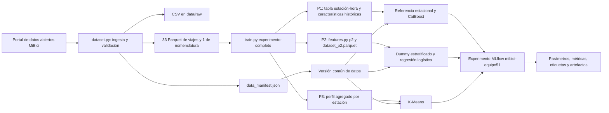
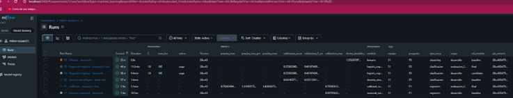
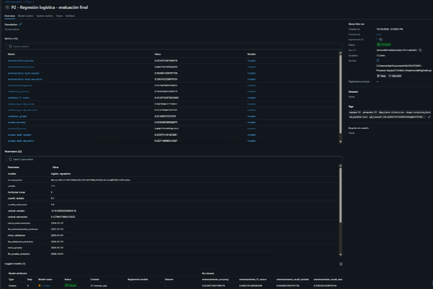
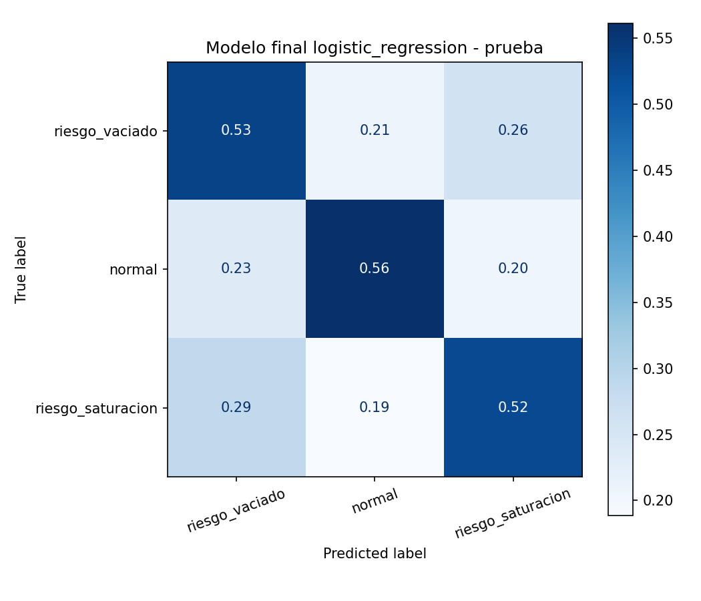
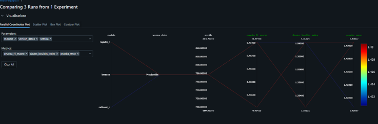

# Proyecto MiBici: experimento reproducible de MLOps

Proyecto integrador de la materia TC5061 para construir y registrar un experimento reproducible a partir de los datos abiertos del sistema MiBici de Guadalajara.

Equipo 51:

- Ariadna del Carmen Tapia Miranda — A01840093
- Gabriela Díaz Oropeza — A01327276
- Ingrid Hernández Carrasco — A01734169

### Roles y colaboración

- Gabriela Díaz Oropeza: responsable principal de P1, predicción de demanda horaria.
- Ingrid Hernández Carrasco: responsable principal de P2, clasificación de riesgo operativo.
- Ariadna del Carmen Tapia Miranda: responsable principal de P3, agrupamiento de estaciones.

Las tres integrantes son colaboradoras del proyecto y participaron en la revisión general, integración y validación de la entrega completa.

### Flujo de trabajo con Git y GitHub

La rama `main` se mantiene protegida y los cambios se integran mediante ramas de trabajo y Pull Requests revisados. Para conservar un historial entendible, se utilizan nombres de ramas como `feat/...` y `fix/...`, junto con mensajes de commit basados en Conventional Commits, por ejemplo `feat:`, `fix:`, `docs:` y `chore:`.

El historial del repositorio evidencia múltiples Pull Requests y contribuciones de las tres integrantes. La captura de la regla de protección de `main` y la evidencia complementaria del trabajo colaborativo se incluyen en el PDF final entregado en Canvas, `TC5061_Propuesta_Proyecto_Equipo51.pdf`.

## 1. Objetivo del proyecto

El proyecto analiza el uso histórico de MiBici desde tres perspectivas que comparten la misma fuente de datos, configuración y trazabilidad en MLflow:

| Pregunta | Objetivo | Tipo de tarea | Resultado esperado |
| --- | --- | --- | --- |
| P1 | Predecir la demanda horaria de viajes | Regresión | Cantidad esperada de viajes por hora |
| P2 | Anticipar riesgo operativo por estación | Clasificación multiclase | `riesgo_vaciado`, `normal` o `riesgo_saturacion` |
| P3 | Agrupar estaciones con patrones de uso similares | Agrupamiento no supervisado | Segmento operativo de cada estación |

El flujo se ejecuta como un solo experimento: primero prepara una versión común de los datos y después construye, entrena y registra las tres preguntas en el mismo experimento de MLflow.

## 2. Datos y reproducibilidad

### Fuente

- Portal oficial: [Datos abiertos de MiBici](https://mibici.net/es/datos-abiertos/)
- Periodo de viajes: enero de 2024 a septiembre de 2026.
- Nomenclatura de estaciones: septiembre de 2026.
- Archivos fuente: 33 CSV mensuales de viajes y 1 CSV de nomenclatura.

La ingesta descubre y descarga los archivos, valida su estructura, normaliza columnas, elimina filas exactamente duplicadas, genera archivos Parquet y actualiza `data_manifest.json`.

El manifiesto registra la URL, tamaño, número de filas y hash SHA-256 de cada archivo. La versión reproducible actual de las fuentes es:

```text
f4ac5ce85e317d512068af3b3707df52f0f6af303bc8ec9ad40180c3301ab5bc
```

### Resultado de la ingesta

| Elemento | Resultado |
| --- | ---: |
| Registros leídos de los CSV | 12,540,018 |
| Registros únicos procesados | 12,539,260 |
| Duplicados exactos eliminados | 758 |
| Estaciones observadas en los viajes | 473 |
| Estaciones presentes en la nomenclatura | 484 |
| Estaciones utilizables después de validar la correspondencia | 471 |
| Parquet de viajes | 33 |
| Parquet de nomenclatura | 1 |

Los identificadores 405 y 407 aparecen en viajes, pero no en la nomenclatura de septiembre de 2026. También existen cuatro estaciones con capacidad igual a cero, ninguna con actividad en el periodo. Estas condiciones se documentan para evitar asumir que todos los identificadores tienen metadatos completos.

### Privacidad y uso responsable

Los modelos trabajan con datos agregados por hora o estación. Las variables personales disponibles en los archivos originales —como identificador de usuario, género y año de nacimiento— no se utilizan como características de modelado. El repositorio tampoco almacena los CSV, los Parquet, modelos serializados, credenciales ni artefactos locales de MLflow.

Esta condición se verificó en las tres preguntas: P1 utiliza estación, calendario y demanda histórica; P2 utiliza estación, capacidad, ubicación y flujos históricos; P3 utiliza ubicación, capacidad y perfiles agregados de entradas y salidas. Ninguna matriz de modelado incluye `usuario_id`, `genero` ni `ano_de_nacimiento`.

La página pública consultada no muestra una licencia explícita para los archivos. Por ello, el proyecto conserva la atribución a MiBici y se limita a un uso académico. También se considera el [aviso de privacidad de MiBici](https://mibici.net/es/aviso-de-privacidad/).

## 3. Diseño de las tres preguntas

### 3.1 Partición temporal

Las particiones respetan el orden cronológico para reducir fuga de información. Cada pregunta utiliza la separación adecuada a su objetivo:

| Pregunta | Entrenamiento | Validación | Prueba |
| --- | --- | --- | --- |
| P1 | Enero de 2024 a diciembre de 2025 | Enero a abril de 2026 | Mayo a septiembre de 2026 |
| P2 | Enero a diciembre de 2024 | Enero a diciembre de 2025 | Enero a septiembre de 2026 |
| P3 | Enero de 2024 a septiembre de 2026 | No aplica: aprendizaje no supervisado | No aplica: aprendizaje no supervisado |

Los límites finales se manejan como exclusivos en el código para evitar traslapes. En P1 y P2, las características históricas usan únicamente información disponible antes del momento que se desea predecir.

### 3.2 P1 — Predicción de demanda horaria

- **Unidad de análisis:** estación-hora.
- **Objetivo:** número de viajes que comienzan en una estación durante una hora.
- **Características:** estación, hora del día, día de la semana, fin de semana, mes, rezagos de 1, 24 y 168 horas, promedios móviles de 3 y 24 horas, e historia disponible.
- **Referencia:** demanda observada 168 horas antes en la misma estación.
- **Modelo evaluado:** CatBoost con 200 iteraciones, profundidad 6 y semilla 777.
- **Métrica principal:** RMSE; como apoyo se registran MAE y MAE en horas con demanda positiva.

### 3.3 P2 — Clasificación de riesgo operativo

- **Unidad de análisis:** estación-hora, incluyendo horas sin viajes entre la primera y la última aparición de cada estación.
- **Objetivo:** clasificar las dos horas siguientes como `riesgo_vaciado`, `normal` o `riesgo_saturacion`.
- **Presión futura:** suma del flujo neto de las dos horas siguientes dividida entre la capacidad de la estación.
- **Umbrales:** cuantiles 10 % y 90 % calculados con entrenamiento, equivalentes a -0.1613 y 0.1579.
- **Características:** calendario, capacidad, ubicación, entradas, salidas y flujo neto históricos, rezagos y promedios móviles. Las entradas, salidas y flujo de la hora que se desea clasificar no se usan como predictores; únicamente se emplea su información de calendario.
- **Referencia:** clasificador aleatorio estratificado.
- **Modelo evaluado:** regresión logística balanceada con semilla 777.
- **Métrica principal:** F1 macro; como apoyo se registran exactitud, sensibilidad por clase, media geométrica y matrices de confusión.

### 3.4 P3 — Agrupamiento de estaciones

- **Unidad de análisis:** estación.
- **Objetivo:** identificar estaciones con patrones de uso parecidos.
- **Características:** latitud, longitud, relación de salidas y entradas en horarios de mañana y tarde, proporción de uso en fin de semana y domingo, y rotación respecto a la capacidad.
- **Preparación:** estandarización de características antes del agrupamiento.
- **Modelo actual:** K-Means con `k=4`, diez inicializaciones y semilla 777.
- **Métricas:** coeficiente de silueta, índice Davies-Bouldin e inercia.
- **Artefacto:** mapa de estaciones coloreado por grupo.

P3 constituye la referencia no supervisada actual. Una extensión futura es compararlo con agrupamiento aglomerativo y revisar la estabilidad de los grupos.

## 4. Flujo y arquitectura del experimento



El comando unificado realiza internamente estos pasos:

1. P1 lee los Parquet, crea la tabla estación-hora, construye características, evalúa el baseline estacional Seasonal Naive (lag_168), lo compara con CatBoost y registra la evaluación final.
2. P2 ejecuta `mibici_mlops.features p2`, crea el conjunto estación-hora, compara el Dummy con la regresión logística y registra la evaluación final.
3. P3 vuelve a leer los Parquet y la nomenclatura, crea el perfil agregado por estación y ejecuta K-Means.
4. Las tres preguntas usan el mismo manifiesto, semilla y experimento de MLflow.
5. Cada paso se ejecuta como un proceso aislado. Si uno falla, la secuencia se detiene.

### Herramientas utilizadas

| Herramienta | Función en el proyecto | Motivo de uso |
| --- | --- | --- |
| Cookiecutter Data Science | Organización del repositorio | Separa datos, código, modelos, reportes y notebooks |
| pandas y PyArrow | Preparación y almacenamiento | Permiten transformar CSV y trabajar con Parquet de forma eficiente |
| scikit-learn | Referencias, clasificación y agrupamiento | Ofrece interfaces consistentes y métricas reproducibles |
| CatBoost | Modelo candidato de P1 | Modela relaciones no lineales en demanda temporal |
| MLflow | Seguimiento experimental | Centraliza parámetros, métricas, etiquetas, artefactos y modelo |
| skops | Serialización del modelo de P2 | Evita depender de formatos de serialización arbitraria |
| pytest y Ruff | Validación automática | Revisan comportamiento crítico y calidad básica del código |
| Git y GitHub | Versionado y colaboración | Vinculan cada corrida con el commit que la produjo |

## 5. Reproducir el experimento completo

### 5.1 Preparar el repositorio y el entorno

Se requiere Git, Python 3.10 y espacio suficiente para descargar y procesar 33 meses de datos.

```powershell
git clone https://github.com/arictamir/TC5061-Proyecto-Equipo51.git
cd TC5061-Proyecto-Equipo51
py -3.10 -m venv .venv
.\.venv\Scripts\Activate.ps1
python -m pip install -r requirements.txt
python -m pip check
```

### 5.2 Ejecutar las pruebas automatizadas — opcional

Este paso es **opcional para reproducir el experimento**, porque las pruebas ya fueron ejecutadas y verificadas por el equipo. Se conserva para quien quiera comprobar nuevamente los componentes automatizados disponibles para P2:

```powershell
python -m pytest tests/test_features_p2.py tests/test_train_p2.py -v
```

Las pruebas son pequeñas y no vuelven a descargar los datos ni ejecutan el entrenamiento completo.

### 5.3 Terminal A: iniciar MLflow

En la terminal actual, inicia MLflow y déjala abierta durante todo el experimento:

```powershell
python -m mlflow ui --host 127.0.0.1 --port 5000
```

Abre [http://127.0.0.1:5000](http://127.0.0.1:5000) en el navegador.

### 5.4 Terminal B: ejecutar la ingesta y el experimento

Abre una segunda terminal en la raíz del repositorio, activa el mismo entorno y ejecuta:

```powershell
.\.venv\Scripts\Activate.ps1
python -m mibici_mlops.dataset
python -m mibici_mlops.modeling.train experimento-completo
```

El primer comando descarga, limpia, valida y versiona las fuentes. El segundo ejecuta de manera secuencial la preparación y los modelos de P1, P2 y P3. No es necesario lanzar comandos separados para cada pregunta.

Al terminar deben existir seis corridas nuevas y exitosas:

1. `P1 - Baseline estacional - desarrollo`.
2. `P1 - CatBoost - evaluación final`.
3. `P2 - Dummy estratificado - desarrollo`.
4. `P2 - Regresión logística - desarrollo`.
5. `P2 - Regresión logística - evaluación final`.
6. `P3 - KMeans - desarrollo`.

## 6. Archivos y artefactos generados

Los datos y modelos grandes se generan localmente y se mantienen fuera de Git. Las figuras seleccionadas pueden incorporarse a la documentación, y la evidencia experimental también se registra en MLflow.

| Etapa | Ruta o artefacto | Contenido |
| --- | --- | --- |
| Ingesta | `data/raw/*.csv` | 33 archivos mensuales y la nomenclatura original |
| Ingesta | `data/processed/trips/*.parquet` | 33 archivos mensuales de viajes limpios |
| Ingesta | `data/processed/nomenclature/nomenclatura_2026_09.parquet` | Nomenclatura limpia de estaciones |
| Ingesta | `data_manifest.json` | Hashes, filas, URLs y versión reproducible |
| P1 | Artefactos `baseline/` y `model/` en MLflow | Metadatos de la referencia y modelo CatBoost `.cbm` |
| P2 | `data/processed/p2/dataset_p2.parquet` | Conjunto estación-hora con características, objetivo y partición |
| P2 | `data/processed/p2/metricas_desarrollo.csv` | Comparación de referencia y modelo en entrenamiento y validación |
| P2 | `data/processed/p2/metricas_finales.csv` | Métricas finales de entrenamiento, validación y prueba |
| P2 | `reports/figures/p2/` | Matrices de confusión de desarrollo y evaluación final |
| P2 | `models/p2/modelo_p2.skops` | Modelo final serializado |
| P3 | `reports/figures/p3_clusters_spatial.png` | Mapa de estaciones por grupo |
| Experimento | `mlruns/` y `mlartifacts/` | Almacenamiento local del servidor MLflow |

P1 no conserva una copia adicional del modelo dentro de `models/`; su modelo se registra directamente como artefacto de MLflow. P3 conserva la visualización local y la registra junto con el manifiesto.

## 7. Trazabilidad en MLflow

Todas las corridas se guardan en el experimento `mibici-equipo51` y comparten una convención común.

Parámetros mínimos:

- `modelo`.
- `semilla`.
- `version_datos`.

Etiquetas mínimas:

- `equipo`.
- `pregunta`.
- `tipo_tarea`.
- `etapa`.
- `rol_modelo`.
- `git_commit`.

Cada pregunta añade sus hiperparámetros y métricas específicas. Los artefactos incluyen, según corresponda, tablas de métricas, matrices de confusión, figuras, manifiesto de datos y modelos serializados.

## 8. Resultados de referencia

### P1 — Predicción de demanda

| Modelo | Conjunto | RMSE | MAE | MAE con demanda positiva |
| --- | --- | ---: | ---: | ---: |
| Referencia estacional | Validación | 2.0318 | 0.9979 | — |
| CatBoost | Validación | 1.4425 | 0.7958 | 1.3167 |
| CatBoost | Prueba | 1.4206 | 0.7827 | 1.3141 |

CatBoost reduce el error frente a la referencia estacional en validación y mantiene un resultado parecido en prueba.

### P2 — Clasificación de riesgo operativo

| Modelo | Conjunto | Exactitud | F1 macro | Sensibilidad vaciado | Sensibilidad saturación | Media geométrica |
| --- | --- | ---: | ---: | ---: | ---: | ---: |
| Dummy estratificado | Validación | 0.6614 | 0.3331 | 0.0995 | 0.1050 | 0.2025 |
| Regresión logística | Validación | 0.5556 | 0.4317 | 0.5601 | 0.5377 | 0.5516 |
| Regresión logística | Prueba | 0.5558 | 0.4041 | 0.5331 | 0.5237 | 0.5390 |

Aunque el clasificador de referencia obtiene mayor exactitud por el desbalance, la regresión logística mejora F1 macro, la media geométrica y el reconocimiento de ambas clases de riesgo. Por eso fue seleccionada mediante validación y después evaluada en prueba.

### P3 — Agrupamiento de estaciones

| Modelo | Estaciones | k | Silhouette | Davies-Bouldin | Inercia |
| --- | ---: | ---: | ---: | ---: | ---: |
| K-Means | 471 | 4 | 0.2479 | 1.3522 | 1765.43 |

La separación es moderada: los grupos ofrecen una primera descripción operativa, pero deben interpretarse junto con sus perfiles y no como categorías definitivas.

## 9. Evidencia de la corrida final

Las siguientes capturas documentan las seis corridas generadas por `experimento-completo`, la trazabilidad de una corrida, un artefacto registrado y la comparación de ejecuciones en MLflow.

### Figura 1. Lista de corridas del experimento
 

 
### Figura 2. Detalle de una corrida
 

 
### Figura 3. Artefacto registrado
 

 
### Figura 4. Comparación de corridas
 


## 10. Organización del repositorio

```text
TC5061-Proyecto-Equipo51/
├── data/
│   ├── raw/                              # CSV descargados; ignorados por Git
│   └── processed/                        # Datos procesados; ignorados por Git
│       ├── trips/                        # 33 Parquet mensuales de viajes
│       ├── nomenclature/                 # Parquet de estaciones
│       └── p2/                           # Dataset y métricas de P2
├── docs/                                 # Sitio de documentación con MkDocs
│   ├── docs/
│   │   ├── getting-started.md
│   │   └── index.md
│   └── mkdocs.yml
├── mibici_mlops/
│   ├── modeling/
│   │   ├── predict.py                    # Plantilla para inferencia
│   │   └── train.py                      # P1, P2, P3 y ejecución unificada
│   ├── config.py                         # Rutas, periodos, semilla y configuración común
│   ├── dataset.py                        # Ingesta, limpieza, validación y manifiesto
│   ├── features.py                       # Características de las tres preguntas
│   └── plots.py                          # Utilidades gráficas
├── models/
│   └── p2/modelo_p2.skops                # Modelo local generado; ignorado por Git
├── notebooks/
│   ├── 1.0-gd-exploracion-p1.ipynb
│   ├── 2.0-ih-p2-eda.ipynb
│   └── 1.0-at-exploracion-p3-clustering.ipynb
├── references/                           # ML Canvas y arquitectura versionados
├── reports/
│   └── figures/
│       ├── p2/                           # Matrices de confusión generadas por P2
│       └── p3_clusters_spatial.png       # Mapa local generado por P3
├── tests/
│   ├── test_features_p2.py
│   └── test_train_p2.py
├── data_manifest.json                    # Versión exacta de las fuentes
├── Makefile
├── pyproject.toml
├── requirements.txt                      # Dependencias fijadas
└── README.md
```

Las carpetas internas mostradas para datos, modelos y artefactos aparecen después de ejecutar el flujo. Sus contenidos, junto con `mlruns/` y `mlartifacts/`, se excluyen mediante `.gitignore`. El repositorio conserva código, configuración, pruebas, documentación y metadatos reproducibles.

## 11. Limitaciones y trabajo futuro

- Los modelos no incorporan clima, eventos, cierres viales ni festivos externos.
- P2 aproxima el riesgo mediante el flujo de viajes y la capacidad; no observa el inventario real de bicicletas y anclajes en cada momento.
- La regresión logística alcanzó el límite de iteraciones configurado; conviene revisar convergencia, escalado e hiperparámetros sin volver a consultar prueba.
- P3 usa actualmente K-Means como referencia. Falta comparar formalmente un segundo algoritmo y validar la estabilidad de los grupos.
- Los datos terminan en septiembre de 2026; se requiere monitoreo temporal para detectar cambios posteriores.
- Un uso operativo necesitaría automatización, monitoreo de calidad y una interfaz para consumir predicciones y segmentos.

## 12. Referencias

- Apache Software Foundation. (s. f.). *Reading and writing the Apache Parquet format*. Apache Arrow. Recuperado el 17 de octubre de 2026, de [https://arrow.apache.org/docs/python/parquet/index.html](https://arrow.apache.org/docs/python/parquet/index.html)
- Cookiecutter Data Science. (s. f.). *Cookiecutter Data Science*. [https://cookiecutter-data-science.drivendata.org/](https://cookiecutter-data-science.drivendata.org/)
- Dorard, L. (2016, 18 de noviembre). *From data to AI with the Machine Learning Canvas (Part I)*. Medium. [https://medium.com/louis-dorard/from-data-to-ai-with-the-machine-learning-canvas-part-i-d171b867b047](https://medium.com/louis-dorard/from-data-to-ai-with-the-machine-learning-canvas-part-i-d171b867b047)
- DrivenData. (s. f.). *Cookiecutter Data Science*. Recuperado el 17 de octubre de 2026, de [https://cookiecutter-data-science.drivendata.org/](https://cookiecutter-data-science.drivendata.org/)
- Equipo 51. (2026). *TC5061-Proyecto-Equipo51* [Repositorio de GitHub]. GitHub. [https://github.com/arictamir/TC5061-Proyecto-Equipo51](https://github.com/arictamir/TC5061-Proyecto-Equipo51)
- Géron, A. (2019). *Hands-on machine learning with Scikit-Learn, Keras, and TensorFlow* (2.ª ed.). O’Reilly Media. [https://www.oreilly.com/library/view/hands-on-machine-learning/9781492032632/](https://www.oreilly.com/library/view/hands-on-machine-learning/9781492032632/)
- Lauchande, N. (2021). *Machine learning engineering with MLflow: Manage the end-to-end machine learning life cycle with MLflow*. Packt Publishing. [https://www.packtpub.com/en-us/product/machine-learning-engineering-with-mlflow-9781800560796](https://www.packtpub.com/en-us/product/machine-learning-engineering-with-mlflow-9781800560796)
- Mi Bici. (s. f.-a). *Aviso de privacidad*. Recuperado el 17 de octubre de 2026, de [https://mibici.net/es/aviso-de-privacidad/](https://mibici.net/es/aviso-de-privacidad/)
- Mi Bici. (s. f.-b). *Datos abiertos*. Recuperado el 17 de octubre de 2026, de [https://mibici.net/es/datos-abiertos/](https://mibici.net/es/datos-abiertos/)
- MLflow. (s. f.). *ML experiment tracking*. Recuperado el 17 de octubre de 2026, de [https://mlflow.org/docs/latest/ml/tracking/](https://mlflow.org/docs/latest/ml/tracking/)
- Scikit-learn developers. (s. f.-a). *DummyClassifier*. Scikit-learn. Recuperado el 17 de octubre de 2026, de [https://scikit-learn.org/stable/modules/generated/sklearn.dummy.DummyClassifier.html](https://scikit-learn.org/stable/modules/generated/sklearn.dummy.DummyClassifier.html)
- Scikit-learn developers. (s. f.-b). *LogisticRegression*. Scikit-learn. Recuperado el 17 de octubre de 2026, de [https://scikit-learn.org/stable/modules/generated/sklearn.linear_model.LogisticRegression.html](https://scikit-learn.org/stable/modules/generated/sklearn.linear_model.LogisticRegression.html)
- Scikit-learn developers. (s. f.-c). *Metrics and scoring: Quantifying the quality of predictions*. Scikit-learn. Recuperado el 17 de octubre de 2026, de [https://scikit-learn.org/stable/modules/model_evaluation.html](https://scikit-learn.org/stable/modules/model_evaluation.html)
- Sculley, D., Holt, G., Golovin, D., Davydov, E., Phillips, T., Ebner, D., Chaudhary, V., Young, M., Crespo, J. F., & Dennison, D. (2015). *Hidden technical debt in machine learning systems*. Advances in Neural Information Processing Systems, 28. [https://papers.nips.cc/paper_files/paper/2015/hash/86df7dcfd896fcaf2674f757a2463eba-Abstract.html](https://papers.nips.cc/paper_files/paper/2015/hash/86df7dcfd896fcaf2674f757a2463eba-Abstract.html)
- Skops developers. (s. f.). *Secure persistence with skops*. Recuperado el 17 de octubre de 2026, de [https://skops.readthedocs.io/en/stable/persistence.html](https://skops.readthedocs.io/en/stable/persistence.html)
- Treveil, M., Omont, N., Stenac, C., Lefevre, K., Phan, D., Zentici, J., Lavoillotte, A., Miyazaki, M., & Heidmann, L. (2020). *Introducing MLOps: How to scale machine learning in the enterprise*. O’Reilly Media. [https://www.oreilly.com/library/view/introducing-mlops/9781492083283/](https://www.oreilly.com/library/view/introducing-mlops/9781492083283/)

### Uso de herramientas de inteligencia artificial generativa

Durante el desarrollo del proyecto se utilizaron ChatGPT (OpenAI) y Gemini (Google) como herramientas de apoyo para la revisión de redacción, organización y documentación del proyecto, así como para discutir y revisar aspectos técnicos. Las decisiones metodológicas, implementación, ejecución de experimentos, análisis de resultados y validación final fueron realizadas por los integrantes del equipo.

## Licencia

El código del repositorio se publica bajo la licencia indicada en [`LICENSE`](LICENSE). Los datos pertenecen a sus fuentes originales y están sujetos a sus términos de uso.

