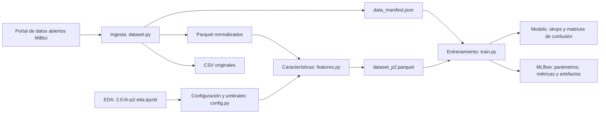

# mibici-mlops-eq51

<a target="_blank" href="https://cookiecutter-data-science.drivendata.org/">
    
</a>

## Proyecto MiBici: propuesta y base reproducible

Este repositorio contiene el desarrollo del proyecto integrador de MLOps basado en los datos abiertos del sistema MiBici. El proyecto utiliza registros de viajes correspondientes al periodo de enero de 2024 a septiembre de 2026, equivalentes a 33 meses de información, junto con la nomenclatura de estaciones disponible para septiembre de 2026.

La ingesta de datos fue diseñada como un proceso reproducible que permite descubrir, descargar, validar, normalizar y convertir los archivos fuente a formato Parquet. Adicionalmente, se genera un manifiesto con información de los archivos y hashes SHA-256 para identificar la versión del conjunto de datos utilizada.

### Periodo de datos

Los datos se utilizan mediante una división cronológica para el desarrollo y evaluación de los modelos. Para P1, la partición temporal implementada es:

| Conjunto | Periodo | Propósito |
| --- | --- | --- |
| Entrenamiento (Train) | Enero de 2024 – diciembre de 2025 | Entrenar el modelo |
| Validación (Validation) | Enero – abril de 2026 | Evaluar configuraciones y seleccionar el modelo final |
| Prueba (Test) | Mayo – septiembre de 2026 | Evaluar una única vez el desempeño final sobre datos posteriores |

Esta estrategia respeta el orden temporal de las observaciones y reduce el riesgo de fuga de información entre los conjuntos. Las características históricas se construyen utilizando únicamente información disponible antes de la hora que se desea predecir.

### Fuente y resultado real de la ingesta

Los datos provienen del [portal de datos abiertos de MiBici](https://mibici.net/es/datos-abiertos/). Los enlaces exactos de los archivos fuente utilizados están registrados en `data_manifest.json`.

La ejecución del pipeline para el periodo configurado produjo:

- **33 meses de datos:** enero de 2024 a septiembre de 2026.
- **12,540,018 registros de viaje** en los archivos CSV fuente.
- **12,539,260 viajes únicos procesados** después de eliminar 758 filas exactamente duplicadas de septiembre de 2026.
- **34 archivos fuente:** 33 archivos mensuales de viajes y 1 archivo de nomenclatura.
- **473 identificadores de estación únicos** observados en los registros de viajes.
- **484 estaciones** presentes en la nomenclatura utilizada.
- **33 archivos Parquet** de viajes y 1 archivo Parquet de nomenclatura.

De los 473 identificadores observados en los viajes, 471 tienen correspondencia en la nomenclatura. Los identificadores `405` y `407`, presentes en 3,954 viajes de junio y julio de 2026, no aparecen en `nomenclatura_2026_09.csv`.

La nomenclatura contiene cuatro estaciones con capacidad igual a cero, pero ninguna presenta actividad durante el periodo analizado.

Los archivos Parquet de viajes comparten un esquema normalizado. Durante el procesamiento se eliminan las filas exactamente duplicadas y los archivos Parquet residuales que no correspondan al periodo configurado.

## Reproducción desde una clonación limpia

Los archivos originales y procesados de MiBici no se almacenan en el repositorio debido a su tamaño. Estos pueden obtenerse automáticamente mediante el pipeline de ingesta.

### Requisitos

- Git.
- Python 3.10.

### 1. Clonar el repositorio

```powershell
git clone https://github.com/arictamir/TC5061-Proyecto-Equipo51.git
cd TC5061-Proyecto-Equipo51
```

### 2. Crear y activar el entorno virtual

```powershell
py -3.10 -m venv .venv
.\.venv\Scripts\Activate.ps1
```

### 3. Instalar y comprobar las dependencias

```powershell
python -m pip install -r requirements.txt
python -m pip check
```

### 4. Abrir una segunda terminal para MLflow

La terminal actual ya tiene el entorno activo. Sin cerrarla, abre una segunda terminal en la raíz del proyecto, activa el mismo entorno y deja el servidor ejecutándose:

```powershell
.\.venv\Scripts\Activate.ps1
python -m mlflow ui --host 127.0.0.1 --port 5000
```

Después abre [http://127.0.0.1:5000](http://127.0.0.1:5000) en el navegador. La segunda terminal debe permanecer abierta mientras se ejecutan los experimentos.

### 5. Regresar a la primera terminal y ejecutar el experimento completo

Regresa a la primera terminal, que conserva el entorno activo desde el paso 2, y ejecuta los siguientes pasos en orden.

#### 5.1 Ingesta de datos

```powershell
python -m mibici_mlops.dataset
```

#### 5.2 Pruebas automatizadas

```powershell
python -m pytest tests/test_features_p2.py tests/test_train_p2.py -v
```

#### 5.3 Ejecución unificada de P1, P2 y P3

```powershell
python -m mibici_mlops.modeling.train experimento-completo
```

El comando unificado ejecuta, en procesos separados, P1, la construcción de características de P2, la comparación y evaluación final de P2, y P3. Si una etapa falla, las siguientes no se ejecutan. Para P2 utiliza `logistic_regression`, seleccionada previamente por su mayor F1 macro de validación. Como este flujo consulta el conjunto de prueba, debe utilizarse para la corrida final y no para ajustar decisiones posteriores.

### Archivos generados localmente

La ingesta utiliza la configuración definida en `mibici_mlops/config.py` para descargar los archivos mensuales correspondientes a enero de 2024 a septiembre de 2026 y la nomenclatura configurada para el proyecto.

Los archivos descargados y procesados se almacenan en:

- `data/raw/`: archivos CSV originales.
- `data/processed/trips/`: registros mensuales de viajes en formato Parquet.
- `data/processed/nomenclature/`: nomenclatura de estaciones procesada.
- `data/processed/p2/dataset_p2.parquet`: conjunto estación-hora de P2.
- `data/processed/p2/`: métricas y matrices de confusión locales.
- `models/p2/`: modelo final serializado.
- `mlruns/` y `mlartifacts/`: metadatos y artefactos locales de MLflow.

Al finalizar también se genera `data_manifest.json`, que contiene el número de registros, tamaño y hash SHA-256 de cada archivo fuente, además de un identificador `dataset_version` calculado a partir de dichos hashes.

Para la versión actual de los datos, el identificador es:

```text
f4ac5ce85e317d512068af3b3707df52f0f6af303bc8ec9ad40180c3301ab5bc
```

Si el portal de MiBici modifica posteriormente alguno de los archivos fuente, el `dataset_version` generado puede ser diferente.

## Buenas prácticas aplicadas

- Dependencias con versiones fijas y Python 3.10 declarado.
- Configuración compartida en `mibici_mlops/config.py`.
- Datos versionados mediante hashes SHA-256 y `dataset_version`.
- Semilla aleatoria fija (`777`) y parámetros registrados en MLflow.
- Separación cronológica de entrenamiento, validación y prueba sin usar el futuro en las características.
- Código ejecutable dentro del paquete; la libreta se usa para EDA, no para entrenar las corridas finales.
- Pruebas pequeñas para objetivo, características, particiones, modelos, métricas y registro de MLflow.
- Datos, artefactos de MLflow y modelos serializados excluidos de Git por su tamaño.
- Sin credenciales ni datos personales en las corridas.

## P1: Predicción de demanda horaria por estación

P1 aborda un problema de regresión cuyo objetivo es predecir cuántos viajes se iniciarán en cada estación durante una hora determinada. Cada observación representa una combinación estación–hora y la variable objetivo es `trips_started`.

Para construir la serie horaria se consideran como horas activas de cada estación aquellas comprendidas entre su primera y última actividad observada como origen o destino. Dentro de este periodo, las horas sin viajes iniciados se representan con demanda igual a cero.

### Características

Las características utilizadas por el modelo son:

- Variables de calendario: `hour_of_day`, `day_of_week`, `is_weekend` y `month`.
- Identificador de estación: `station_id`.
- Rezagos históricos: `lag_1`, `lag_24` y `lag_168`.
- Medias móviles: `rolling_mean_3h` y `rolling_mean_24h`.
- Historial disponible: `history_hours`.

Los rezagos y medias móviles utilizan únicamente información anterior a la hora objetivo. En particular, las medias móviles se calculan después de desplazar la serie una hora para evitar fuga de información.

### Modelos y evaluación

Se utilizó como baseline un modelo estacional ingenuo que predice la demanda utilizando el valor observado 168 horas antes (`lag_168`).

El modelo final es un `CatBoostRegressor` con 200 iteraciones, profundidad 6, `learning_rate=0.1` y semilla 42.

| Modelo | Validation MAE | Validation RMSE |
| --- | ---: | ---: |
| Seasonal Naive (`lag_168`) | 0.9979 | 2.0318 |
| CatBoostRegressor | 0.7972 | 1.4458 |

Una vez seleccionado el modelo mediante el conjunto de validación, se realizó la evaluación final sobre el conjunto de prueba:

| Métrica | Test |
| --- | ---: |
| MAE | 0.8187 |
| RMSE | 1.4499 |
| MAE en horas con demanda positiva | 1.3278 |

Los experimentos se registran en MLflow junto con sus parámetros, métricas, versión de datos, commit de Git y artefactos.

### Reproducir el entrenamiento de P1

Una vez ejecutada la ingesta y con el entorno virtual activo:

```powershell
python -m mibici_mlops.modeling.train main


## P2: clasificación de riesgo operativo

### Problema y utilidad

P2 es un problema de clasificación multiclase. Para cada estación y hora estima el riesgo operativo durante las dos horas siguientes:

- `riesgo_vaciado`: la estación podría quedarse con pocas bicicletas.
- `normal`: no se observa una presión extrema.
- `riesgo_saturacion`: la estación podría quedarse sin anclajes disponibles.

La unidad de análisis es **estación-hora** y el horizonte de predicción es de **2 horas**. El resultado puede apoyar al personal operativo en la priorización del rebalanceo de bicicletas antes de que ocurra un posible vaciado o saturación.

### Construcción del objetivo

Los datos abiertos registran viajes, pero no contienen un inventario histórico de bicicletas y anclajes disponibles. Por ello se utiliza una variable aproximada basada en el flujo futuro:

```text
flujo_neto = entradas - salidas
presion_futura_2h = (flujo_neto de t+1 + flujo_neto de t+2) / capacidad
```

Los umbrales se calcularon únicamente con entrenamiento (2024) para no utilizar información de validación o prueba:

| Clase | Regla |
| --- | --- |
| Riesgo de vaciado | `presion_futura_2h <= -0.1612903226` |
| Normal | Valor entre ambos umbrales |
| Riesgo de saturación | `presion_futura_2h >= 0.1578947368` |

Estos límites corresponden aproximadamente a los cuantiles 10 % y 90 % del conjunto de entrenamiento. Se eligieron porque conservan suficientes casos de ambos riesgos sin producir una cantidad excesiva de alertas.

### Datos y características

El conjunto de P2 contiene **9,032,205 filas estación-hora** correspondientes a **471 estaciones**:

| Conjunto | Periodo | Filas |
| --- | --- | ---: |
| Entrenamiento | Enero–diciembre de 2024 | 3,156,754 |
| Validación | Enero–diciembre de 2025 | 3,234,174 |
| Prueba | Enero–septiembre de 2026 | 2,641,277 |

Las 17 características incluyen ubicación y capacidad de la estación, variables de calendario, rezagos de 1, 2 y 24 horas, y promedios móviles históricos. Todos los rezagos y promedios usan información anterior a la hora que se quiere predecir. Además, se excluyen del final de cada partición las horas cuyo objetivo de dos horas cruzaría al siguiente conjunto.

Las estaciones `405` y `407` no se incorporan a P2 porque no tienen correspondencia ni capacidad disponible en la nomenclatura utilizada.

### Uso y privacidad de los datos

El [portal de datos abiertos de MiBici](https://mibici.net/es/datos-abiertos/) publica los archivos mensuales e invita a explorar, experimentar y compartir sus datos. La página de descarga no indica una licencia específica de reutilización, por lo que se deben consultar el portal y sus condiciones vigentes antes de redistribuir los archivos fuente. Este repositorio no almacena los CSV ni los Parquet; conserva únicamente el código y el manifiesto reproducible.

Aunque los archivos originales incluyen campos relacionados con personas usuarias, P2 no utiliza `usuario_id`, `genero` ni `ano_de_nacimiento`. Solo lee fechas y estaciones de origen y destino, y después agrega los movimientos por estación-hora. Tampoco se registran datos personales ni credenciales en MLflow. El tratamiento debe mantenerse alineado con el [aviso de privacidad de MiBici](https://mibici.net/es/aviso-de-privacidad/).

### Arquitectura del pipeline



### Modelos y métricas

Se compararon dos enfoques:

- **Baseline:** `DummyClassifier(strategy="stratified")`, que predice respetando aproximadamente la proporción de las clases.
- **Candidato:** regresión logística con escalamiento, codificación de estación y `class_weight="balanced"`.

La selección se hizo exclusivamente con **F1 macro de validación**. También se registraron `accuracy`, recall de riesgo de vaciado, recall de riesgo de saturación y G-Mean. F1 macro y G-Mean evitan que la clase normal oculte un mal desempeño en las clases de riesgo; los recalls miden cuántas alertas reales de cada tipo consigue detectar el modelo.

### Resultados

Resultados de desarrollo usados para seleccionar el modelo:

| Modelo | Conjunto | Accuracy | F1 macro | Recall vaciado | Recall saturación | G-Mean |
| --- | --- | ---: | ---: | ---: | ---: | ---: |
| Dummy estratificado | Entrenamiento | 0.6532 | 0.3337 | 0.1006 | 0.1056 | 0.2036 |
| Dummy estratificado | Validación | 0.6614 | 0.3331 | 0.0995 | 0.1050 | 0.2025 |
| Regresión logística | Entrenamiento | 0.5534 | 0.4402 | 0.5840 | 0.5393 | 0.5579 |
| Regresión logística | Validación | 0.5556 | 0.4317 | 0.5601 | 0.5377 | 0.5516 |

La regresión logística fue seleccionada porque superó al Dummy en F1 macro, G-Mean y recall de ambas clases críticas. Su menor `accuracy` muestra por qué esa métrica no debe usarse sola en este problema desbalanceado.

Después de seleccionar el modelo con validación, se evaluó una sola vez en prueba:

| Modelo final | Accuracy | F1 macro | Recall vaciado | Recall saturación | G-Mean |
| --- | ---: | ---: | ---: | ---: | ---: |
| Regresión logística | 0.5558 | 0.4041 | 0.5331 | 0.5237 | 0.5390 |

### Trazabilidad con MLflow

El experimento se llama `mibici-equipo51` y contiene tres corridas descriptivas:

1. `P2 - Dummy estratificado - desarrollo`.
2. `P2 - Regresión logística - desarrollo`.
3. `P2 - Regresión logística - evaluación final`.

Cada corrida registra la versión de datos, periodos, semilla, horizonte, modelo, hiperparámetros, métricas con prefijo por conjunto y etiquetas de equipo, pregunta, etapa y commit de Git. También se guardan matrices de confusión; la corrida final incluye el manifiesto, las métricas, el modelo serializado y un modelo MLflow con firma y ejemplo de entrada.

Evidencias:

- [Lista de las tres corridas](reports/figures/p2/evidencias_mlflow/Evidencia1_P2_3Runs.png).
- [Detalle de la corrida final](reports/figures/p2/evidencias_mlflow/Evidencia2_P2_RegresionFinal.png).
- [Matriz de confusión de prueba como artefacto](reports/figures/p2/evidencias_mlflow/Evidencia3_P2_Artefacto_MatrizDeConfusion_Prueba.png).
- [Comparación del Dummy y la regresión logística](reports/figures/p2/evidencias_mlflow/Evidencia4_P2_Dummy_vs_LR.png).

### Limitaciones actuales

- La presión futura es una aproximación basada en flujos, no una medición directa del inventario de bicicletas y anclajes.
- No se incorporan todavía clima, días festivos ni eventos especiales.
- La regresión logística alcanza el límite de iteraciones con `max_iter=100`. Una prueba con 300 iteraciones produjo métricas prácticamente iguales y aumentó considerablemente el tiempo de ejecución; por eso se conserva 100 para este baseline. El aviso debe revisarse antes de considerar un uso productivo.
- El periodo de prueba de 2026 contiene únicamente enero–septiembre.

## Pregunta 3 (P3): Agrupamiento y Perfiles de Uso de Estaciones (Clustering)

* **Objetivo de Negocio:** Identificar arquetipos funcionales de estaciones y analizar su distribución espacial en el Área Metropolitana de Guadalajara (AMG) para guiar decisiones de planeación urbana, expansión de polígonos y redimensionamiento estructural de infraestructura por parte de IMEPLAN y MiBici.
* **Tipo de Tarea:** Aprendizaje no supervisado (Clustering).
* **Entidad de Análisis:** Estación consolidada (`station_id`), caracterizada mediante un vector multidimensional estático derivado del historial operativo (Enero 2024 – Septiembre 2026).
* **Horizonte:** No aplica horizonte predictivo secuencial; se analiza el comportamiento estructural agregado a nivel estación.

#### 1. Ingeniería de Características (`mibici_mlops/features.py`)
A partir de los viajes y la nomenclatura oficial, se extrajo una huella funcional de 7 variables normalizadas por estación:
* **`ratio_am`**: Razón de viajes salientes respecto a entrantes en hora pico matutina (07:00–10:00). Valores altos identifican estaciones predominantemente de origen/residenciales.
* **`ratio_pm`**: Razón de viajes salientes respecto a entrantes en hora pico vespertina (18:00–21:00). Valores bajos indican zonas de atracción laboral/comercial.
* **`pct_fin_semana`**: Proporción de viajes en sábado y domingo respecto al total, separando la movilidad utilitaria de la recreativa.
* **`pct_domingo`**: Proporción de viajes dominicales, aislando el impacto directo del corredor de la Vía RecreActiva en el AMG.
* **`rotacion_capacidad`**: Volumen total de viajes atendidos (entradas + salidas) dividido entre la capacidad instalada de anclajes, midiendo la intensidad de uso físico.
* **`latitude` y `longitude`**: Coordenadas geográficas WGS84 para contextualizar la continuidad y proximidad espacial de los grupos.

#### 2. Modelo Baseline y Métricas de Evaluación
* **Modelo Baseline:** $K$-Means ($k=4$, `n_init=10`, `random_state=777`) entrenado sobre las características estandarizadas con `StandardScaler`.
* **Métricas de Evaluación:**
  * **Silhouette Score:** Cohesión y separación entre clústeres (rango $[-1, 1]$).
  * **Davies-Bouldin Index (DBI):** Similitud promedio entre cada clúster y su más cercano (valores menores indican mejor separación).
  * **Inertia:** Suma de distancias al cuadrado de las muestras a su centroide más cercano.

#### 3. Resultados del Experimento Base (MLflow Tracking)
* **Experimento:** `mibici-equipo51`
* **Run:** `P3 - KMeans - desarrollo`
* **Estaciones analizadas:** 471 estaciones activas.
* **Resultados Obtenidos:**
  * `silhouette_score`: **0.2492**
  * `davies_bouldin_index`: **1.3458**
  * `inercia`: Registrada en el run
* **Artefacto:** Mapa geoespacial de asignación de clusters registrado en `reports/figures/p3_clusters_spatial.png` y vinculado al artefacto del run en MLflow.

#### 4. Comandos de Reproducción
Para ejecutar el pipeline de extracción de variables, entrenamiento y registro en MLflow:

```powershell
# Ejecutar pipeline de P3 desde la raíz del repositorio
python -m mibici_mlops.modeling.train p3

# Visualizar resultados en MLflow UI
python -m mlflow ui --host 127.0.0.1 --port 5000
```

## Project Organization

```
├── LICENSE            <- Open-source license if one is chosen
├── Makefile           <- Makefile with convenience commands like `make data` or `make train`
├── README.md          <- The top-level README for developers using this project.
├── data
│   ├── processed      <- Datos procesados en formato Parquet.
│   └── raw            <- Archivos CSV originales de MiBici.
│
├── docs               <- A default mkdocs project; see www.mkdocs.org for details
│
├── models             <- Trained and serialized models, model predictions, or model summaries
│
├── notebooks          <- Jupyter notebooks. Naming convention is a number (for ordering),
│                         the creator's initials, and a short `-` delimited description, e.g.
│                         `1.0-jqp-initial-data-exploration`.
│
├── pyproject.toml     <- Project configuration file with package metadata for 
│                         mibici_mlops and configuration for tools like black
│
├── references         <- Data dictionaries, manuals, and all other explanatory materials.
│
├── reports            <- Generated analysis as HTML, PDF, LaTeX, etc.
│   └── figures        <- Generated graphics and figures to be used in reporting
│
├── requirements.txt   <- The requirements file for reproducing the analysis environment, e.g.
│                         generated with `pip freeze > requirements.txt`
│
├── setup.cfg          <- Configuration file for flake8
│
└── mibici_mlops   <- Source code for use in this project.
    │
    ├── __init__.py             <- Makes mibici_mlops a Python module
    │
    ├── config.py               <- Store useful variables and configuration
    │
    ├── dataset.py              <- Scripts to download or generate data
    │
    ├── features.py             <- Code to create features for modeling
    │
    ├── modeling                
    │   ├── __init__.py 
    │   ├── predict.py          <- Code to run model inference with trained models          
    │   └── train.py            <- Code to train models
    │
    └── plots.py                <- Code to create visualizations
```

--------
