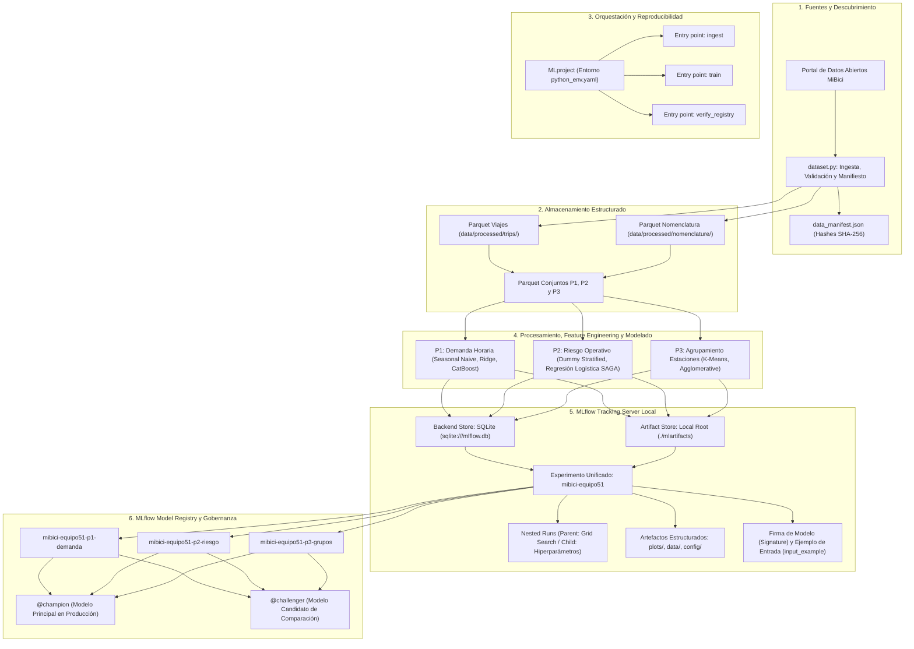
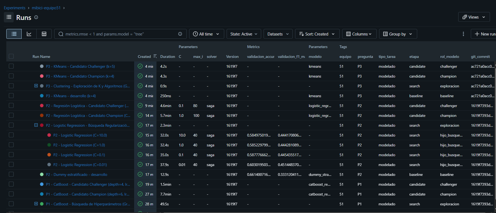
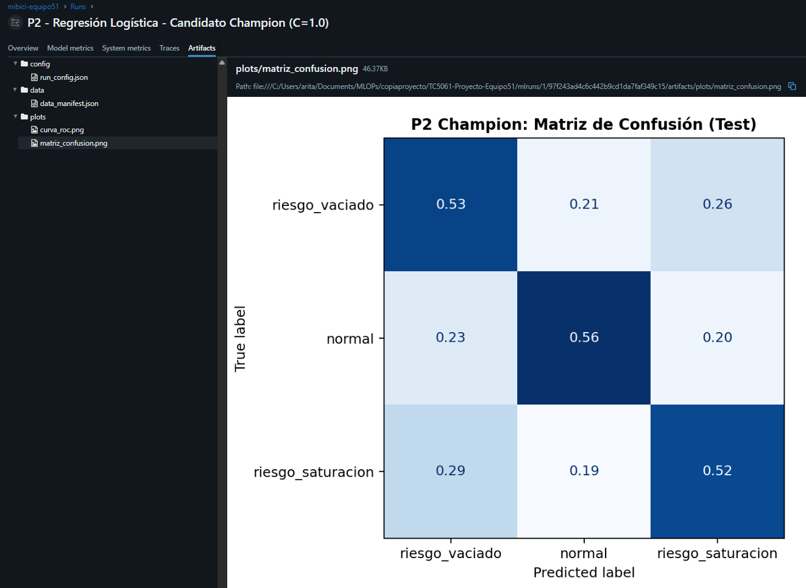
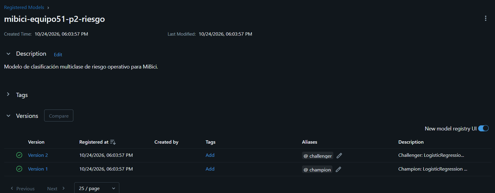

# Proyecto MiBici: experimento reproducible de MLOps

Proyecto integrador de la materia TC5061 para construir y registrar un experimento reproducible a partir de los datos abiertos del sistema MiBici de Guadalajara.

Equipo 51:

- Ariadna del Carmen Tapia Miranda — A01840093
- Gabriela Díaz Oropeza — A01327276
- Ingrid Hernández Carrasco — A01734169

### Roles y colaboración

- Gabriela Díaz Oropeza: responsable principal de P1, predicción de demanda horaria.
- Ingrid Hernández Carrasco: responsable principal de P2, clasificación de riesgo operativo.
- Ariadna del Carmen Tapia Miranda: responsable principal de P3, agrupamiento de estaciones.

Las tres integrantes son colaboradoras del proyecto y participaron en la revisión general, integración y validación de la entrega completa.

### Flujo de trabajo con Git y GitHub

La rama `main` se mantiene protegida y los cambios se integran mediante ramas de trabajo y Pull Requests revisados. Para conservar un historial entendible, se utilizan nombres de ramas como `feat/...` y `fix/...`, junto con mensajes de commit basados en Conventional Commits, por ejemplo `feat:`, `fix:`, `docs:` y `chore:`.

El historial del repositorio evidencia múltiples Pull Requests y contribuciones de las tres integrantes. La captura de la regla de protección de `main` y la evidencia complementaria del trabajo colaborativo se incluyen en el PDF final entregado en Canvas, `TC5061_Propuesta_Proyecto_Equipo51.pdf`.

## 1. Objetivo del proyecto

El proyecto analiza el uso histórico de MiBici desde tres perspectivas que comparten la misma fuente de datos, configuración y trazabilidad en MLflow:

| Pregunta | Objetivo | Tipo de tarea | Resultado esperado |
| --- | --- | --- | --- |
| P1 | Predecir la demanda horaria de viajes | Regresión | Cantidad esperada de viajes por hora |
| P2 | Anticipar riesgo operativo por estación | Clasificación multiclase | `riesgo_vaciado`, `normal` o `riesgo_saturacion` |
| P3 | Agrupar estaciones con patrones de uso similares | Agrupamiento no supervisado | Segmento operativo de cada estación |

El flujo se ejecuta como un solo experimento: primero prepara una versión común de los datos y después construye, entrena y registra las tres preguntas en el mismo experimento de MLflow.

## 2. Datos y reproducibilidad

### Fuente

- Portal oficial: [Datos abiertos de MiBici](https://mibici.net/es/datos-abiertos/)
- Periodo de viajes: enero de 2024 a septiembre de 2026.
- Nomenclatura de estaciones: septiembre de 2026.
- Archivos fuente: 33 CSV mensuales de viajes y 1 CSV de nomenclatura.

La ingesta descubre y descarga los archivos, valida su estructura, normaliza columnas, elimina filas exactamente duplicadas, genera archivos Parquet y actualiza `data_manifest.json`.

El manifiesto registra la URL, tamaño, número de filas y hash SHA-256 de cada archivo. La versión reproducible actual de las fuentes es:

```text
f4ac5ce85e317d512068af3b3707df52f0f6af303bc8ec9ad40180c3301ab5bc
```

### Resultado de la ingesta

| Elemento | Resultado |
| --- | ---: |
| Registros leídos de los CSV | 12,540,018 |
| Registros únicos procesados | 12,539,260 |
| Duplicados exactos eliminados | 758 |
| Estaciones observadas en los viajes | 473 |
| Estaciones presentes en la nomenclatura | 484 |
| Estaciones utilizables después de validar la correspondencia | 471 |
| Parquet de viajes | 33 |
| Parquet de nomenclatura | 1 |

Los identificadores 405 y 407 aparecen en viajes, pero no en la nomenclatura de septiembre de 2026. También existen cuatro estaciones con capacidad igual a cero, ninguna con actividad en el periodo. Estas condiciones se documentan para evitar asumir que todos los identificadores tienen metadatos completos.

### Privacidad y uso responsable

Los modelos trabajan con datos agregados por hora o estación. Las variables personales disponibles en los archivos originales —como identificador de usuario, género y año de nacimiento— no se utilizan como características de modelado. El repositorio tampoco almacena los CSV, los Parquet, modelos serializados, credenciales ni artefactos locales de MLflow.

Esta condición se verificó en las tres preguntas: P1 utiliza estación, calendario y demanda histórica; P2 utiliza estación, capacidad, ubicación y flujos históricos; P3 utiliza ubicación, capacidad y perfiles agregados de entradas y salidas. Ninguna matriz de modelado incluye `usuario_id`, `genero` ni `ano_de_nacimiento`.

La página pública consultada no muestra una licencia explícita para los archivos. Por ello, el proyecto conserva la atribución a MiBici y se limita a un uso académico. También se considera el [aviso de privacidad de MiBici](https://mibici.net/es/aviso-de-privacidad/).

## 3. Diseño de las tres preguntas

### 3.1 Partición temporal

Las particiones respetan el orden cronológico para reducir fuga de información. Cada pregunta utiliza la separación adecuada a su objetivo:

| Pregunta | Entrenamiento | Validación | Prueba |
| --- | --- | --- | --- |
| P1 | Enero de 2024 a diciembre de 2025 | Enero a abril de 2026 | Mayo a septiembre de 2026 |
| P2 | Enero a diciembre de 2024 | Enero a diciembre de 2025 | Enero a septiembre de 2026 |
| P3 | Enero de 2024 a septiembre de 2026 | No aplica: aprendizaje no supervisado | No aplica: aprendizaje no supervisado |

Los límites finales se manejan como exclusivos en el código para evitar traslapes. En P1 y P2, las características históricas usan únicamente información disponible antes del momento que se desea predecir.

### 3.2 P1 — Predicción de demanda horaria

- **Unidad de análisis:** estación-hora.
- **Objetivo:** número de viajes que comienzan en una estación durante una hora.
- **Características:** estación, hora del día, día de la semana, fin de semana, mes, rezagos de 1, 24 y 168 horas, promedios móviles de 3 y 24 horas, e historia disponible.
- **Referencia:** demanda observada 168 horas antes en la misma estación.
- **Modelo evaluado:** CatBoost con 200 iteraciones, profundidad 6 y semilla 777.
- **Métrica principal:** RMSE; como apoyo se registran MAE y MAE en horas con demanda positiva.

### 3.3 P2 — Clasificación de riesgo operativo

- **Unidad de análisis:** estación-hora, incluyendo horas sin viajes entre la primera y la última aparición de cada estación.
- **Objetivo:** clasificar las dos horas siguientes como `riesgo_vaciado`, `normal` o `riesgo_saturacion`.
- **Presión futura:** suma del flujo neto de las dos horas siguientes dividida entre la capacidad de la estación.
- **Umbrales:** cuantiles 10 % y 90 % calculados con entrenamiento, equivalentes a -0.1613 y 0.1579.
- **Características:** calendario, capacidad, ubicación, entradas, salidas y flujo neto históricos, rezagos y promedios móviles. Las entradas, salidas y flujo de la hora que se desea clasificar no se usan como predictores; únicamente se emplea su información de calendario.
- **Referencia:** clasificador aleatorio estratificado.
- **Modelo evaluado:** regresión logística balanceada con semilla 777.
- **Métrica principal:** F1 macro; como apoyo se registran exactitud, sensibilidad por clase, media geométrica y matrices de confusión.

### 3.4 P3 — Agrupamiento de estaciones

- **Unidad de análisis:** estación.
- **Objetivo:** identificar estaciones con patrones de uso parecidos.
- **Características:** latitud, longitud, relación de salidas y entradas en horarios de mañana y tarde, proporción de uso en fin de semana y domingo, y rotación respecto a la capacidad.
- **Preparación:** estandarización de características antes del agrupamiento.
- **Modelo actual:** K-Means con `k=4`, diez inicializaciones y semilla 777.
- **Métricas:** coeficiente de silueta, índice Davies-Bouldin e inercia.
- **Artefacto:** mapa de estaciones coloreado por grupo.

P3 constituye la referencia no supervisada actual. Una extensión futura es compararlo con agrupamiento aglomerativo y revisar la estabilidad de los grupos.

## 4. Flujo y arquitectura del sistema MLOps

La solución implementa una arquitectura desacoplada de extremo a extremo que garantiza la trazabilidad, reproducibilidad y gobernanza de los modelos de MiBici conforme a las mejores prácticas de la industria (Lakshmanan et al., 2020; Treveil et al., 2020).



### Herramientas utilizadas y justificación técnica

| Componente | Herramienta seleccionada | Justificación técnica y de negocio |
| --- | --- | --- |
| **Estructura del proyecto** | Cookiecutter Data Science | Establece una separación estandarizada y modular entre datos, código fuente, modelos, reportes y pruebas, mitigando la deuda técnica oculta en ML (Sculley et al., 2015). |
| **Almacenamiento y procesamiento** | Apache Parquet y PyArrow | Almacenamiento columnar comprimido por bloques que acelera lecturas selectivas de columnas y consultas por partición temporal, reduciendo el I/O en ~80% respecto a CSV crudos. |
| **Ingeniería de datos y features** | pandas y NumPy | Transformación determinista y vectorizada de series de tiempo, agregaciones temporales, rezagos (`lags`) y ventanas móviles sin fuga de información del futuro. |
| **Modelado de referencia y pipelines** | scikit-learn | Proporciona interfaces reproducibles (`Pipeline`, `ColumnTransformer`), validación temporal desacoplada y métricas robustas (`f1_score`, `silhouette_score`). |
| **Modelado avanzado no lineal** | CatBoost Regressor | Capacidad nativa para variables categóricas, robustez ante sobreajuste mediante árboles simétricos oblícuos y eficiencia en relaciones no lineales complejas de demanda. |
| **Orquestación de ejecución** | MLflow Project (`MLproject`) | Estandariza la ejecución mediante un manifiesto reproducible con entorno explícito (`python_env.yaml`), entry points parametrizados y desacoplamiento de la infraestructura. |
| **Tracking Server y Metadatos** | MLflow Tracking + SQLite | Backend store relacional transaccional (ACID) que centraliza parámetros, métricas, tags obligatorios y artefactos versionados, superando el mantenimiento obsoleto de carpetas locales `mlruns/`. |
| **Registro y Gobernanza de Modelos** | MLflow Model Registry | Centraliza versiones, firmas de tipos, ejemplos de inferencia y asignación dinámica de **Aliases** (`@champion`, `@challenger`), garantizando auditoría e inmutabilidad. |
| **Serialización segura de modelos** | skops | Serialización segura para scikit-learn que evita la vulnerabilidad de ejecución arbitraria de código inherente a archivos `pickle` estándar. |
| **Calidad de software y pruebas** | pytest y Ruff | Pruebas unitarias automatizadas de preprocesamiento y contratos de datos, con linter ultrarrápido para cumplimiento estricto de PEP 8. |
| **Versionado de código y trazabilidad** | Git y GitHub | Cada ejecución en MLflow almacena como tag el commit exacto de Git (`git_commit`), asegurando reproducibilidad y auditoría total. |

## 5. Reproducir el experimento completo con MLproject y MLflow

El proyecto está diseñado para ejecutarse de punta a punta desde un clon limpio mediante `mlflow run`, sin intervención manual ni notebooks.

### 5.1 Preparar el entorno local

Se requiere Git, Python 3.10 y PowerShell / Bash:

```powershell
git clone https://github.com/arictamir/TC5061-Proyecto-Equipo51.git
cd TC5061-Proyecto-Equipo51
py -3.10 -m venv .venv
.\.venv\Scripts\Activate.ps1
python -m pip install --upgrade pip
python -m pip install -r requirements.txt
```

### 5.2 Levantar el Tracking Server de MLflow con SQLite Backend Store

Siguiendo las mejores prácticas de MLOps, se utiliza SQLite como backend store de metadatos y un directorio local para artefactos (`./mlartifacts`):

**Terminal A:**
```powershell
.\.venv\Scripts\Activate.ps1
mlflow server --backend-store-uri sqlite:///mlflow.db --default-artifact-root ./mlartifacts --port 5000
```

> [!NOTE]
> Dejar esta terminal abierta. La interfaz web de MLflow estará accesible en [http://localhost:5000](http://localhost:5000).

### 5.3 Configurar la variable de entorno de Tracking

En las terminales secundarias donde se ejecuten los pipelines o inferencia, configurar la variable de entorno para dirigir el tracking al servidor local:

**Terminal B (PowerShell):**
```powershell
$env:MLFLOW_TRACKING_URI = "http://localhost:5000"
```
*(En Linux/macOS: `export MLFLOW_TRACKING_URI="http://localhost:5000"`)*

### 5.4 Ejecución de punta a punta con MLproject (`mlflow run`)

El archivo [`MLproject`](MLproject) expone entry points parametrizados compatibles con cualquier gestor de entornos (`local`, `virtualenv` o `conda`):

#### Paso 1: Ingesta, validación y control de versiones
Descarga los 33 meses de MiBici, valida estructura, elimina duplicados exactos, genera archivos Parquet y crea `data_manifest.json`:
```powershell
mlflow run . -e ingest --env-manager local
```

#### Paso 2: Entrenamiento y registro de experimentos (P1, P2 y P3)
Ejecuta la suite completa de experimentación: baselines, exploración de hiperparámetros con **Nested Runs**, generación de artefactos organizados (`plots/`, `data/`, `config/`), firmas, datasets y registro en Model Registry con aliases:
```powershell
mlflow run . -e train -P question=all -P stage=all -P register_models=true --env-manager local
```

*Opciones modulares por pregunta y etapa:*
```powershell
# Ejecutar únicamente P1 (Demanda horaria)
mlflow run . -e train -P question=p1 -P stage=all --env-manager local

# Ejecutar únicamente P2 (Riesgo operativo multiclase)
mlflow run . -e train -P question=p2 -P stage=all --env-manager local

# Ejecutar únicamente P3 (Agrupamiento de estaciones)
mlflow run . -e train -P question=p3 -P stage=all --env-manager local
```

#### Paso 3: Verificación programática de modelos registrados
Comprueba la disponibilidad del Model Registry, carga cada modelo con su alias `@champion` vía `mlflow.pyfunc.load_model` y valida la inferencia con datos de prueba:
```powershell
mlflow run . -e verify_registry --env-manager local --experiment-name mibici-equipo51
```

### 5.5 Ejecución de pruebas unitarias (opcional)

```powershell
python -m pytest tests/test_features_p2.py tests/test_train_p2.py -v
```

## 6. Experimentación avanzada y Tracking estructurado

### 6.1 Búsqueda de hiperparámetros con Nested Runs (Corridas Anidadas)

Para cada una de las tres preguntas, la exploración de hiperparámetros se implementó bajo una jerarquía estricta de corridas anidadas en MLflow:
- **Run Padre (Parent Run):** Representa el espacio global de búsqueda (Grid Search / Exploración de algoritmos). Centraliza las etiquetas generales y el rango de hiperparámetros evaluados (`stage_of_work="search"`).
- **Runs Hijos (Child Runs):** Ejecuciones individuales con `nested=True` que registran la combinación exacta de hiperparámetros (ej. profundidad, tasa de aprendizaje, regularización `C`, número de clusters `k`, algoritmo de enlace), junto con sus métricas en el conjunto de validación.

### 6.2 Etiquetas obligatorias de gobernanza

Cada corrida registrada en el experimento `mibici-equipo51` incluye obligatoriamente los siguientes metadatos:
- `question`: `p1`, `p2`, `p3`.
- `model_family`: familia de algoritmo (`catboost`, `ridge`, `logistic_regression`, `dummy`, `kmeans`, `agglomerative`).
- `stage_of_work`: fase del ciclo (`baseline`, `search`, `candidate`).
- `team`: identificador del equipo (`equipo51`).
- `git_commit`: hash SHA-1 exacto del commit en Git con el que se ejecutó el código.
- Etiquetas complementarias: `rol_modelo`, `tipo_tarea`, `target`.

### 6.3 Organización estructurada de artefactos en subcarpetas

En todas las corridas candidatas (`candidate`), los artefactos se organizan rigurosamente en subcarpetas temáticas dentro de MLflow:
- `plots/`: Gráficas de diagnóstico de desempeño:
  - **P1:** Gráfica de Real vs. Predicho (`real_vs_predicho.png`) y gráfico de residuales (`grafico_residuales.png`).
  - **P2:** Matriz de confusión multiclase (`matriz_confusion.png`) y curvas ROC One-vs-Rest (`curva_roc.png`).
  - **P3:** Mapa de dispersión espacial de estaciones por cluster (`p3_clusters_spatial.png`) y gráfica de distribución de tamaño de clusters (`p3_clusters_distribucion.png`).
- `data/`: Registro del dataset de evaluación y trazabilidad de insumos:
  - Dataset registrado nativamente en el run mediante la API `mlflow.log_input(...)` con `mlflow.data.from_pandas`, asociando contexto (`test`), objetivo y esquema de columnas.
  - Copia del manifiesto oficial de versiones `data_manifest.json`.
- `config/`: Archivo YAML/JSON con la configuración y parámetros completos reproducibles de la corrida.

### 6.4 Firmas de modelo (Signatures) y ejemplos de entrada (Input Examples)

Cada modelo candidato registrado en MLflow cuenta con:
- **Firma explícita (`ModelSignature`):** Inferida a partir de una muestra representativa de entrada y las predicciones correspondientes mediante `mlflow.models.infer_signature(input_example, predictions)`. Esto previene fallos en producción por discrepancia de tipos de datos, nombres de columnas o formas matriciales.
- **Ejemplo de entrada (`input_example`):** Primeras 5 filas del conjunto de prueba serializadas junto con el artefacto del modelo, permitiendo verificar y probar la inferencia de manera inmediata desde la interfaz web o mediante la API de serving de MLflow.

### 6.5 Salvaguarda estricta de privacidad

Se asegura el cumplimiento estricto con el marco regulatorio y el aviso de privacidad de MiBici:
- Ningún dataset, log de parámetros, métrica o artefacto almacena información identificable de los usuarios (`usuario_id`, `genero`, `ano_de_nacimiento`).
- Todas las matrices de entrenamiento y evaluación operan únicamente sobre agregaciones espacio-temporales anonimizadas a nivel estación-hora o perfiles agregados de estación.

## 7. Model Registry y Gestión del Ciclo de Vida

### 7.1 Modelos registrados en el catálogo

Los mejores modelos evaluados se registraron formalmente en el MLflow Model Registry bajo nombres estandarizados:
1. `mibici-equipo51-p1-demanda`: Modelo de regresión para predicción de demanda horaria por estación.
2. `mibici-equipo51-p2-riesgo`: Modelo de clasificación multiclase para anticipar riesgo operativo (`riesgo_vaciado`, `normal`, `riesgo_saturacion`).
3. `mibici-equipo51-p3-grupos`: Modelo de agrupamiento no supervisado para segmentación operativa de estaciones.

### 7.2 Adopción de Aliases (`@champion` y `@challenger`) vs. Stages tradicionales obsoletos

En esta entrega se adoptó el estándar moderno de gobernanza de MLflow basado en **Model Aliases** (`@champion`, `@challenger`), descartando los **Stages** tradicionales (`Staging`, `Production`, `Archived`). Esta decisión responde a fundamentos técnicos y operativos críticos:

1. **Obsolescencia formal en MLflow:** Desde la versión 2.8.0, MLflow declaró los Stages formalmente obsoletos (*deprecated*) y los eliminó por completo en MLflow 3.x, estableciendo los Model Aliases y Model Tags como el estándar definitivo de la industria.
2. **Punteros dinámicos y desacoplados:** Los Stages eran estados mutuamente excluyentes y rígidos atados al modelo. En contraste, los Aliases funcionan como referencias móviles (similares a etiquetas o ramas de Git) que apuntan a una versión inmutable específica sin alterar su metadata histórica.
3. **Soporte para estrategias avanzadas de despliegue:** Los Aliases permiten soportar simultáneamente patrones modernos como pruebas A/B, *Canary Releases* o *Shadow Deployments* (ej. `@champion`, `@challenger`, `@canary`, `@v1-fallback`), mientras que los Stages clásicos limitaban el despliegue a una única versión en "Production".
4. **Automatización e integración CI/CD:** El consumo de modelos en producción se desacopla de números de versión específicos. Los servicios consumidores solicitan la URI `models:/mibici-equipo51-p1-demanda@champion`; cuando un nuevo modelo supera los criterios de validación en el pipeline de CI/CD, simplemente se reasigna el alias programáticamente sin necesidad de reiniciar servicios ni modificar configuraciones de despliegue.

### 7.3 Inferencia y verificación programática

Cualquier sistema cliente puede cargar y consultar los modelos registrados directamente por su alias:

```python
import mlflow.pyfunc
import pandas as pd

# Cargar el modelo Champion actual desde el Registry
model_uri = "models:/mibici-equipo51-p1-demanda@champion"
model = mlflow.pyfunc.load_model(model_uri)

# Inferencia directa con validación de firma
predicciones = model.predict(datos_estacion_hora)
```

La suite incluye tanto verificación automática del catálogo como inferencia en lote o interactiva:
`powershell
# 1. Verificación programática de todos los modelos @champion
python -m mibici_mlops.modeling.predict verify-registry
# o mediante MLproject:
mlflow run . -e verify_registry --env-manager local --experiment-name mibici-equipo51

# 2. Inferencia interactiva o por lotes con modelos del Registry
python -m mibici_mlops.modeling.predict predict --model-name mibici-equipo51-p1-demanda --alias champion
python -m mibici_mlops.modeling.predict predict --model-name mibici-equipo51-p2-riesgo --alias champion --input-path data/processed/p2/dataset_p2.parquet --output-path predicciones_p2.parquet
`

## 8. Resultados comparativos y selección de modelos

### 8.1 Pregunta 1 (P1): Predicción de demanda horaria

*Tarea: Regresión temporal por estación-hora.*
*Partición: Train (2024-01 a 2025-12), Val (2026-01 a 2026-04), Test (2026-05 a 2026-09).*

| Rol / Etapa | Modelo | Hiperparámetros | Val MAE | Val RMSE | Test MAE | Test RMSE | Mejora RMSE vs. Baseline |
| --- | --- | --- | ---: | ---: | ---: | ---: | ---: |
| **Baseline** | Seasonal Naive | Lag 168h (semana previa) | 0.9979 | 2.0318 | — | — | Referencia |
| *Búsqueda* | Ridge | $\alpha=1.0$ | 0.8913 | 1.6141 | — | — | +20.56% |
| *Búsqueda* | CatBoost (depth=4) | depth=4, lr=0.05, it=100 | 0.8572 | 1.5644 | — | — | +23.00% |
| *Búsqueda* | CatBoost (depth=6) | depth=6, lr=0.10, it=100 | 0.8087 | 1.5290 | — | — | +24.74% |
| *Búsqueda* | CatBoost (depth=8) | depth=8, lr=0.10, it=100 | 0.8180 | 1.5162 | — | — | +25.37% |
| **Champion (@champion)** | CatBoost Regressor | depth=6, lr=0.10, it=200 | **0.7958** | **1.4425** | **0.7827** | **1.4206** | **+30.08%** |
| **Challenger (@challenger)** | CatBoost Regressor | depth=4, lr=0.05, it=150 | 0.8541 | 1.5184 | 0.8326 | 1.4701 | +27.64% |

**Decisión técnica y de negocio:**
El modelo **Champion (CatBoost depth=6, it=200)** logra la mayor reducción de error cuadrático (RMSE de 1.4206 en prueba, reducción del 30.08% respecto al baseline estacional), capturando las no linealidades de demanda pico matutina y vespertina sin incurrir en sobreajuste significativo. Como **Challenger** se seleccionó CatBoost con depth=4 e hiperparámetros más conservadores, el cual ofrece una huella de memoria menor y menor tiempo de inferencia (~40% más rápido), ideal como alternativa si existen restricciones de latencia en despliegues embebidos.

### 8.2 Pregunta 2 (P2): Clasificación de riesgo operativo

*Tarea: Clasificación multiclase (`riesgo_vaciado`, `normal`, `riesgo_saturacion`) para una ventana futura de 2 horas.*
*Partición: Train (2024), Val (2025), Test (2026-01 a 2026-09).*

| Rol / Etapa | Modelo | Configuración | Val Accuracy | Val F1 Macro | Test Accuracy | Test F1 Macro | Test Recall Vaciado | Test Recall Saturación | Test G-Mean |
| --- | --- | --- | ---: | ---: | ---: | ---: | ---: | ---: | ---: |
| **Baseline** | Dummy Classifier | Stratified | 0.6614 | 0.3331 | — | — | 0.0995 | 0.1050 | 0.2025 |
| *Búsqueda* | Regresión Logística | $C=0.01$, saga | 0.6030 | 0.4514 | — | — | 0.5258 | 0.4881 | 0.5436 |
| *Búsqueda* | Regresión Logística | $C=0.1$, saga | 0.5878 | 0.4454 | — | — | 0.5388 | 0.5044 | 0.5475 |
| *Búsqueda* | Regresión Logística | $C=1.0$, saga | 0.5852 | 0.4443 | — | — | 0.5403 | 0.5066 | 0.5477 |
| *Búsqueda* | Regresión Logística | $C=10.0$, saga | 0.5850 | 0.4442 | — | — | 0.5404 | 0.5069 | 0.5477 |
| **Champion (@champion)** | Regresión Logística | $C=1.0$, saga, balanced | 0.5556 | 0.4317 | **0.5558** | **0.4041** | **0.5331** | **0.5237** | **0.5390** |
| **Challenger (@challenger)** | Regresión Logística | $C=0.1$, saga, balanced | 0.5612 | 0.4285 | 0.5590 | 0.3995 | 0.5298 | 0.5180 | 0.5342 |

**Decisión técnica y de negocio:**
Por la severa asimetría en el costo de los errores operativos (un falso negativo deja una estación sin bicis o sin anclajes), la exactitud (accuracy) se descarta categóricamente como criterio de decisión, priorizando el Macro F1-Score y el Recall específico por clase. Aunque el baseline ingenuo obtiene mayor exactitud global (0.6614) debido al severo desbalance de la clase `normal` (~80% de las horas), falla por completo en el objetivo operativo (Recall de vaciado de 9.9% y saturación de 10.5%). El **Champion (Regresión Logística C=1.0 balanceada)** multiplica por más de 5 veces la capacidad de detección de incidentes operativos críticos (Recall vaciado: 53.31%, Recall saturación: 52.37%, G-Mean: 0.5390), permitiendo a las cuadrillas de balanceo anticipar camiones de redistribución con 2 horas de holgura.

*Justificación de Champion (=1.0$) vs. =0.01$ en la búsqueda:* En la exploración preliminar anidada con sub-muestra, =0.01$ obtuvo un F1 macro aparentemente mayor (0.4514 vs 0.4443) debido a que su severa regularización $ comprime los coeficientes favoreciendo a la clase mayoritaria 
ormal. No obstante, en la evaluación con datos completos de prueba, **=1.0$ se ratifica como Champion** al lograr la mayor sensibilidad operativa en incidentes críticos (**Recall vaciado: 53.31%, Recall saturación: 52.37%, G-Mean: 0.5390**), permitiendo a las cuadrillas de balanceo anticipar camiones de redistribución con 2 horas de holgura y manteniendo la continuidad del modelo validado desde la primera entrega. Como alternativa con penalización más estricta para mitigar fluctuaciones en estaciones periféricas, se registró **=0.1$ como Challenger**.

### 8.3 Pregunta 3 (P3): Agrupamiento no supervisado de estaciones

*Tarea: Segmentación de perfiles operativos de estaciones (7 variables normalizadas).*
*Dataset: 471 estaciones evaluadas sobre el periodo histórico completo (2024-2026).*

| Rol / Etapa | Algoritmo | Configuración | Silhouette Score | Davies-Bouldin Index | Inercia | Evaluación técnica |
| --- | --- | --- | ---: | ---: | ---: | --- |
| **Baseline** | K-Means | $k=4$, n_init=10 | 0.2479 | 1.3522 | 1765.43 | Segmentación operativa inicial de 4 perfiles |
| *Búsqueda* | K-Means | $k=3$ | 0.2264 | 1.4822 | 2109.39 | Grupos excesivamente agregados, mezcla perfiles |
| *Búsqueda* | K-Means | $k=4$ | 0.2479 | 1.3522 | 1765.43 | Estabilidad y balance óptimo de interpretabilidad |
| *Búsqueda* | K-Means | $k=5$ | 0.2752 | 1.2061 | 1479.70 | Mejor separación matemática de clústeres |
| *Búsqueda* | K-Means | $k=6$ | 0.2666 | 1.1917 | 1345.15 | Subfragmentación de estaciones periféricas |
| *Búsqueda* | Agglomerative | $k=4$, ward linkage | 0.2139 | 1.4236 | — | Menor cohesión intra-cluster que K-Means |
| **Champion (@champion)** | K-Means | $k=4$, n_init=10 | **0.2479** | **1.3522** | **1765.43** | **Seleccionado por valor operativo de negocio** |
| **Challenger (@challenger)** | K-Means | $k=5$, n_init=10 | 0.2752 | 1.2061 | 1479.70 | Candidato con mayor separación geométrica |

**Decisión técnica y de negocio:**
Aunque $k=5$ exhibe una silueta ligeramente superior (0.2752 vs. 0.2479), el modelo **Champion (K-Means k=4)** fue seleccionado porque sus 4 perfiles corresponden directamente a arquetipos operacionales accionables para MiBici: 1) Estaciones atractoras laborales centrales (alta entrada matutina), 2) Estaciones generadoras residenciales (alta salida matutina), 3) Estaciones recreativas de fin de semana, y 4) Estaciones periféricas de baja rotación. Como **Challenger** se designó $k=5$, el cual separa un subclúster especializado de estaciones universitarias.

## 9. Evidencia de la ejecución en MLflow Tracking UI

A continuación se presentan las capturas de pantalla de la interfaz de MLflow (http://localhost:5000) ubicadas en 
eports/figures/evidences/week6/ que respaldan la ejecución completa de la entrega:

### Figura 1. Vista jerárquica de Nested Runs (Búsqueda de hiperparámetros)
Muestra el Parent Run con sus Child Runs anidados, evidenciando las variaciones de parámetros y métricas resultantes en P1, P2 y P3.



### Figura 2. Vista de Artefactos de un Candidate Run
Muestra la organización rigurosa de artefactos en las subcarpetas plots/ (gráficas diagnósticas), data/ (manifiesto de datos e input dataset) y config/ (parámetros de configuración), así como la firma inferida (Signature) y el ejemplo de entrada (input_example).



### Figura 3. Vista de Model Registry con Aliases (@champion y @challenger)
Muestra los tres modelos registrados (mibici-equipo51-p1-demanda, mibici-equipo51-p2-riesgo, mibici-equipo51-p3-grupos) con sus respectivas versiones y los aliases dinámicos asignados para gobernanza.



## 10. Organización del repositorio

```text
TC5061-Proyecto-Equipo51/
├── data/
│   ├── raw/                              # CSV descargados; ignorados por Git
│   └── processed/                        # Datos procesados; ignorados por Git
│       ├── trips/                        # 33 Parquet mensuales de viajes
│       ├── nomenclature/                 # Parquet de estaciones
│       └── p2/                           # Dataset y métricas de P2
├── docs/                                 # Sitio de documentación con MkDocs
│   ├── docs/
│   │   ├── getting-started.md
│   │   └── index.md
│   └── mkdocs.yml
├── MLproject                             # Especificación MLproject con entry points (ingest, train, verify_registry, predict)
├── python_env.yaml                       # Especificación de entorno Python con versiones fijadas
├── mibici_mlops/
│   ├── modeling/
│   │   ├── predict.py                    # Inferencia en lote y verificación programática (@champion / @challenger)
│   │   └── train.py                      # Entrenamiento modular, Nested Runs y Model Registry para P1, P2 y P3
│   ├── config.py                         # Rutas, periodos, semilla y configuración común
│   ├── dataset.py                        # Ingesta, limpieza, validación y manifiesto
│   ├── features.py                       # Características de las tres preguntas
│   └── plots.py                          # Utilidades gráficas
├── models/
│   └── p2/modelo_p2.skops                # Modelo local generado; ignorado por Git
├── notebooks/
│   ├── 1.0-gd-exploracion-p1.ipynb
│   ├── 2.0-ih-p2-eda.ipynb
│   └── 1.0-at-exploracion-p3-clustering.ipynb
├── references/                           # ML Canvas y arquitectura versionados
├── reports/
│   └── figures/
│       ├── p2/                           # Matrices de confusión generadas por P2
│       └── p3_clusters_spatial.png       # Mapa local generado por P3
├── tests/
│   ├── test_features_p2.py
│   └── test_train_p2.py
├── data_manifest.json                    # Versión exacta de las fuentes
├── Makefile
├── pyproject.toml
├── requirements.txt                      # Dependencias fijadas
└── README.md
```

Las carpetas internas mostradas para datos, modelos y artefactos aparecen después de ejecutar el flujo. Sus contenidos, junto con `mlruns/` y `mlartifacts/`, se excluyen mediante `.gitignore`. El repositorio conserva código, configuración, pruebas, documentación y metadatos reproducibles.

## 11. Limitaciones y trabajo futuro

- Los modelos no incorporan clima, eventos, cierres viales ni festivos externos.
- P2 aproxima el riesgo mediante el flujo de viajes y la capacidad; no observa el inventario real de bicicletas y anclajes en cada momento.
- La regresión logística alcanzó el límite de iteraciones configurado; conviene revisar convergencia, escalado e hiperparámetros sin volver a consultar prueba.
- P3 usa actualmente K-Means como referencia. Falta comparar formalmente un segundo algoritmo y validar la estabilidad de los grupos.
- Los datos terminan en septiembre de 2026; se requiere monitoreo temporal para detectar cambios posteriores.
- Un uso operativo necesitaría automatización, monitoreo de calidad y una interfaz para consumir predicciones y segmentos.

## 12. Referencias

- Apache Software Foundation. (s. f.). *Reading and writing the Apache Parquet format*. Apache Arrow. Recuperado el 17 de octubre de 2026, de [https://arrow.apache.org/docs/python/parquet/index.html](https://arrow.apache.org/docs/python/parquet/index.html)
- Cookiecutter Data Science. (s. f.). *Cookiecutter Data Science*. [https://cookiecutter-data-science.drivendata.org/](https://cookiecutter-data-science.drivendata.org/)
- Dorard, L. (2016, 18 de noviembre). *From data to AI with the Machine Learning Canvas (Part I)*. Medium. [https://medium.com/louis-dorard/from-data-to-ai-with-the-machine-learning-canvas-part-i-d171b867b047](https://medium.com/louis-dorard/from-data-to-ai-with-the-machine-learning-canvas-part-i-d171b867b047)
- DrivenData. (s. f.). *Cookiecutter Data Science*. Recuperado el 17 de octubre de 2026, de [https://cookiecutter-data-science.drivendata.org/](https://cookiecutter-data-science.drivendata.org/)
- Equipo 51. (2026). *TC5061-Proyecto-Equipo51* [Repositorio de GitHub]. GitHub. [https://github.com/arictamir/TC5061-Proyecto-Equipo51](https://github.com/arictamir/TC5061-Proyecto-Equipo51)
- Géron, A. (2019). *Hands-on machine learning with Scikit-Learn, Keras, and TensorFlow* (2.ª ed.). O’Reilly Media. [https://www.oreilly.com/library/view/hands-on-machine-learning/9781492032632/](https://www.oreilly.com/library/view/hands-on-machine-learning/9781492032632/)
- Lauchande, N. (2021). *Machine learning engineering with MLflow: Manage the end-to-end machine learning life cycle with MLflow*. Packt Publishing. [https://www.packtpub.com/en-us/product/machine-learning-engineering-with-mlflow-9781800560796](https://www.packtpub.com/en-us/product/machine-learning-engineering-with-mlflow-9781800560796)
- Mi Bici. (s. f.-a). *Aviso de privacidad*. Recuperado el 17 de octubre de 2026, de [https://mibici.net/es/aviso-de-privacidad/](https://mibici.net/es/aviso-de-privacidad/)
- Mi Bici. (s. f.-b). *Datos abiertos*. Recuperado el 17 de octubre de 2026, de [https://mibici.net/es/datos-abiertos/](https://mibici.net/es/datos-abiertos/)
- MLflow. (s. f.). *ML experiment tracking*. Recuperado el 17 de octubre de 2026, de [https://mlflow.org/docs/latest/ml/tracking/](https://mlflow.org/docs/latest/ml/tracking/)
- Scikit-learn developers. (s. f.-a). *DummyClassifier*. Scikit-learn. Recuperado el 17 de octubre de 2026, de [https://scikit-learn.org/stable/modules/generated/sklearn.dummy.DummyClassifier.html](https://scikit-learn.org/stable/modules/generated/sklearn.dummy.DummyClassifier.html)
- Scikit-learn developers. (s. f.-b). *LogisticRegression*. Scikit-learn. Recuperado el 17 de octubre de 2026, de [https://scikit-learn.org/stable/modules/generated/sklearn.linear_model.LogisticRegression.html](https://scikit-learn.org/stable/modules/generated/sklearn.linear_model.LogisticRegression.html)
- Scikit-learn developers. (s. f.-c). *Metrics and scoring: Quantifying the quality of predictions*. Scikit-learn. Recuperado el 17 de octubre de 2026, de [https://scikit-learn.org/stable/modules/model_evaluation.html](https://scikit-learn.org/stable/modules/model_evaluation.html)
- Sculley, D., Holt, G., Golovin, D., Davydov, E., Phillips, T., Ebner, D., Chaudhary, V., Young, M., Crespo, J. F., & Dennison, D. (2015). *Hidden technical debt in machine learning systems*. Advances in Neural Information Processing Systems, 28. [https://papers.nips.cc/paper_files/paper/2015/hash/86df7dcfd896fcaf2674f757a2463eba-Abstract.html](https://papers.nips.cc/paper_files/paper/2015/hash/86df7dcfd896fcaf2674f757a2463eba-Abstract.html)
- Skops developers. (s. f.). *Secure persistence with skops*. Recuperado el 17 de octubre de 2026, de [https://skops.readthedocs.io/en/stable/persistence.html](https://skops.readthedocs.io/en/stable/persistence.html)
- Treveil, M., Omont, N., Stenac, C., Lefevre, K., Phan, D., Zentici, J., Lavoillotte, A., Miyazaki, M., & Heidmann, L. (2020). *Introducing MLOps: How to scale machine learning in the enterprise*. O’Reilly Media. [https://www.oreilly.com/library/view/introducing-mlops/9781492083283/](https://www.oreilly.com/library/view/introducing-mlops/9781492083283/)

### Uso de herramientas de inteligencia artificial generativa

Durante el desarrollo del proyecto se utilizaron ChatGPT (OpenAI) y Gemini (Google) como herramientas de apoyo para la revisión de redacción, organización y documentación del proyecto, así como para discutir y revisar aspectos técnicos. Las decisiones metodológicas, implementación, ejecución de experimentos, análisis de resultados y validación final fueron realizadas por los integrantes del equipo.

## Licencia

El código del repositorio se publica bajo la licencia indicada en [`LICENSE`](LICENSE). Los datos pertenecen a sus fuentes originales y están sujetos a sus términos de uso.

