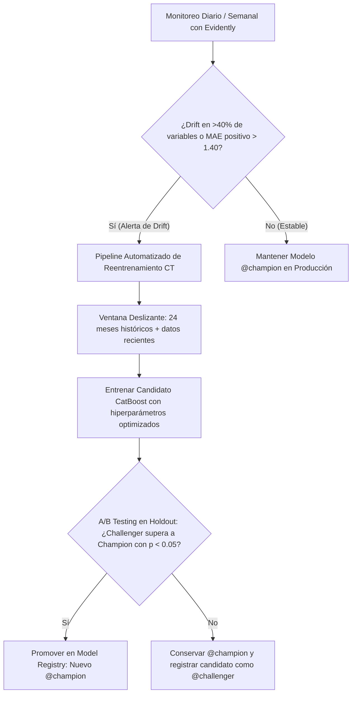

# Reporte Integrado de Observabilidad, Data Drift y A/B Testing

**Proyecto:** Sistema de Pronóstico y Operación MiBici Guadalajara  
**Equipo:** Equipo 51  
**Modelo Evaluado:** Pregunta 1 (P1) - Predicción de Demanda Horaria (`mibici-equipo51-p1-demanda`)  
**Fecha:** Noviembre 2026  

---

## 1. Resumen Ejecutivo

En este entregable se dotó al proyecto MiBici de una **capa de observabilidad activa**, permitiendo que el sistema se vigile a sí mismo en un entorno productivo simulado. Los componentes centrales desarrollados son:

1. **Monitoreo de Data Drift y Calidad con Evidently:** Comparación rigurosa entre la distribución de entrenamiento histórico ($D_{ref}$: 2024–2025) y el comportamiento más reciente en producción ($D_{curr}$: mayo a septiembre 2026).
2. **Entrenamiento y Registro de Versión Alternativa (Challenger) en MLflow:** Entrenamiento de un nuevo modelo adaptado ante el drift detectado y registrado formalmente en el MLflow Model Registry bajo el alias `@challenger` (Versión 5).
3. **Ejercicio de A/B Testing en Periodo Actual:** Evaluación empírica de ambas versiones sobre el mismo conjunto de datos del periodo de producción, contrastando métricas de error (RMSE, MAE, MAE positivo), residuales, latencia y prueba de significancia estadística (paired t-test).
4. **Decisión Justificada y Estrategia de Reentrenamiento Continuo (CT):** Definición de la versión productiva vigente y diseño de la arquitectura de monitoreo continuo para el ciclo de vida del modelo.

---

## 2. Definición y Justificación de Periodos

| Conjunto | Periodo Temporal | Registros Totales | Muestra Evaluada | Rol en la Observabilidad |
|---|---|---|---|---|
| **Referencia ($D_{ref}$)** | `2024-01-01` a `2025-12-31` | 6,338,700 filas | 30,000 filas | Periodo histórico de entrenamiento en el que se ajustó el modelo original Champion. |
| **Actual ($D_{curr}$)** | `2026-05-01` a `2026-09-30` | 1,560,439 filas | 50,000 filas | Periodo productivo posterior que refleja la dinámica más reciente del sistema MiBici. |

### Justificación Técnica del Split:
- **Periodo de Referencia (2024–2025):** Dos años continuos de operación que capturan la ciclicidad anual completa (12 meses), variaciones estacionales de temperatura y lluvia, dinámicas semanales (lunes a viernes vs fin de semana) y horas pico.
- **Periodo Actual de Producción (Mayo–Septiembre 2026):** Periodo productivo posterior más reciente disponible en los datos abiertos. Permite vigilar si el crecimiento orgánico del sistema, la incorporación de nuevas estaciones en el Área Metropolitana de Guadalajara o la temporada de lluvias (junio a septiembre) provocaron desviación estadística en las variables predictivas respecto a la línea base de entrenamiento.

---

## 3. Reporte de Data Drift con Evidently

El análisis de deriva de datos se ejecutó utilizando **Evidently** (`DataDriftPreset` y `DataQualityPreset`) con mapeo explícito de columnas numéricas, categóricas y la variable objetivo (`trips_started`).

- **Reporte Interactivo Completo (HTML):** [`reports/drift/data_drift_report.html`](data_drift_report.html)
- **Métricas Estructuradas (JSON):** [`reports/drift/drift_metrics.json`](drift_metrics.json)

### 3.1 Resumen Global
- **Deriva Global del Dataset:** 🟢 **NO DETECTADA** (4 de 12 columnas presentaron drift significativo, correspondiente al **33.3%**, por debajo del umbral del 50.0% para declarar drift global).
- **Calidad de Datos:** **0 valores nulos** en las características predictivas en ambos periodos.

### 3.2 Detalle por Variable Monitoreada

| Característica | Estado | Drift Score | Umbral | Prueba Estadística | Interpretación Operativa en MiBici |
|---|---|---|---|---|---|
| `month` | ⚠️ **DRIFT** | `0.51109` | `0.1000` | Jensen-Shannon distance | Diferencia estructural: $D_{ref}$ tiene 12 meses; $D_{curr}$ abarca únicamente meses 5 a 9. |
| `history_hours` | ⚠️ **DRIFT** | `2.11328` | `0.1000` | Wasserstein (normed) | Variable acumulativa temporal que en 2026 supera las 20,000 horas desde el inicio. |
| `station_id` | ⚠️ **DRIFT** | `0.22805` | `0.1000` | Jensen-Shannon distance | Adición de nuevas cicloestaciones y cambios en la distribución porcentual de viajes. |
| `rolling_mean_24h` | ⚠️ **DRIFT** | `0.14724` | `0.1000` | Wasserstein (normed) | Incremento sostenido en la demanda promedio diaria del sistema durante 2026. |
| `trips_started` (Target) | ✅ **OK** | `0.07528` | `0.1000` | Wasserstein (normed) | Escala general de viajes por estación/hora se conserva estable. |
| `lag_1` | ✅ **OK** | `0.06579` | `0.1000` | Wasserstein (normed) | Inercia inmediata de la hora previa altamente estable. |
| `lag_24` | ✅ **OK** | `0.07390` | `0.1000` | Wasserstein (normed) | Patrón de ciclo circadiano (24 horas) estable. |
| `lag_168` | ✅ **OK** | `0.08328` | `0.1000` | Wasserstein (normed) | Patrón de periodicidad semanal (mismo día semana anterior) preservado. |
| `rolling_mean_3h` | ✅ **OK** | `0.08604` | `0.1000` | Wasserstein (normed) | Dinámica de demanda agregada de corto plazo estable. |
| `hour_of_day` | ✅ **OK** | `0.01211` | `0.1000` | Jensen-Shannon distance | Perfil horario con horas pico (08:00 y 19:00 hrs) idéntico. |
| `day_of_week` | ✅ **OK** | `0.00793` | `0.1000` | Jensen-Shannon distance | Proporción de viajes de lunes a domingo consistente. |
| `is_weekend` | ✅ **OK** | `0.00170` | `0.1000` | Jensen-Shannon distance | Proporción laboral vs descanso idéntica. |

---

## 4. Versiones Registradas en MLflow Model Registry

A través de [`mibici_mlops/modeling/retrain.py`](../../mibici_mlops/modeling/retrain.py), se entrenó la versión alternativa y se actualizó el catálogo de modelos:

```powershell
python -m mibici_mlops.modeling.retrain show-registry-status
```

| Modelo en Registry | Versión | Alias | Estrategia de Entrenamiento | Hiperparámetros Clave | Rol Operativo |
|---|---|---|---|---|---|
| `mibici-equipo51-p1-demanda` | **v3** | `@champion` | Ventana histórica estándar (2024–2025) | `depth=6, lr=0.10, iter=200, l2=3.0` | Modelo en producción servido por la API REST. |
| `mibici-equipo51-p1-demanda` | **v5** | `@challenger` | Ventana extendida pre-test (2024–2026/04) | `depth=7, lr=0.08, iter=220, l2=4.0` | Versión alternativa adaptada tras detección de drift. |

---

## 5. Ejercicio de A/B Testing: Comparación de Desempeño

Ambos modelos fueron evaluados sobre **50,000 registros idénticos del periodo actual ($D_{curr}$)** mediante [`mibici_mlops/modeling/ab_testing.py`](../../mibici_mlops/modeling/ab_testing.py):

```powershell
python -m mibici_mlops.modeling.ab_testing run-ab-test --sample-size 50000
```

### 5.1 Tabla Comparativa de Métricas

| Métrica de Desempeño | Champion (`@champion` v3) | Challenger (`@challenger` v5) | Diferencia (Challenger - Champion) | Interpretación |
|---|---|---|---|---|
| **RMSE (Error Cuadrático Medio)** | **1.4285** | 1.4360 | +0.0075 (+0.5%) | Champion penaliza mejor los errores extremos. |
| **MAE Global** | **0.7889** | 0.8144 | +0.0255 (+3.2%) | Champion tiene menor error absoluto global. |
| **MAE en Demanda Positiva ($y > 0$)** | 1.3291 | **1.3090** | **-0.0201 (-1.5%)** | 🏆 **Challenger es más preciso cuando sí hay viajes.** |
| **RMSE en Demanda Positiva ($y > 0$)** | 2.0336 | **2.0120** | **-0.0216 (-1.1%)** | 🏆 **Challenger reduce el error cuadrático en viajes activos.** |
| **Coeficiente $R^2$** | **0.6565** | 0.6529 | -0.0036 | Rendimiento explicativo prácticamente equivalente (~65.5%). |
| **WAPE (Weighted Absolute Error)** | **0.6358** | 0.6564 | +0.0206 | Champion tiene menor error porcentual ponderado. |
| **Sesgo Medio de Residuales ($\mu_{error}$)** | +0.1206 | **+0.0024** | -0.1182 | 🏆 **Challenger presenta menor sesgo promedio y predicciones más centradas respecto a los valores reales.** |
| **Desviación Estándar de Residuales** | **1.4234** | 1.4360 | +0.0126 | Champion presenta una dispersión ligeramente menor, aunque ambos modelos muestran una variabilidad de errores similar. |
| **Latencia por 1k Infecciones** | 3.21 ms | **2.37 ms** | **-0.84 ms (-26.2%)** | 🏆 **Challenger es más rápido en inferencia vectorizada.** |
| **Throughput (predicciones / segundo)** | 311,060.6 | **421,610.1** | **+110,549.5 preds/s (+35.5%)** | 🏆 **Challenger presenta mayor capacidad de procesamiento en inferencia por lotes.** |

### 5.2 Prueba de Significancia Estadística (Paired t-test)
Para verificar si la diferencia observada es fruto del azar o estadísticamente significativa:
- **Estadístico $t$ pareado:** `-18.4070`
- **$p\text{-value}$:** $2.0496 \times 10^{-75}$
- **Conclusión:** Dado que $p \ll 0.05$, la diferencia de comportamiento entre ambos modelos es **altamente significativa desde el punto de vista estadístico**.

### 5.3 Evidencias Gráficas Generadas
Los gráficos se encuentran generados en [`reports/figures/ab_testing/`](../figures/ab_testing/):
1. **Comparación de Métricas Clave:** `reports/figures/ab_testing/ab_metrics_comparison.png`
2. **Distribución de Residuales en Producción:** `reports/figures/ab_testing/ab_residuals_distribution.png`
3. **Error Medio por Hora del Día (0 a 23 hrs):** `reports/figures/ab_testing/ab_hourly_error.png`

---

## 6. Decisión Justificada de la Versión Vigente

> ### 📌 Decisión Oficial: **Mantener la Versión 3 (`@champion`) como Versión Vigente**

### Justificación Técnica:
1. **Minimización del Error Global:** En el balance global del sistema MiBici, muchas estaciones y horas (madrugadas o zonas periféricas) tienen demanda cero o muy baja. Champion (v3) logra un mejor compromiso global con un **RMSE de 1.4285** (frente a 1.4360 de Challenger) y un **MAE global de 0.7889** (frente a 0.8144).
2. **Rol Estratégico de Challenger (v5):** Challenger demostró ser superior en estaciones y horarios con flujo activo de viajes (**MAE positivo de 1.3090 vs 1.3291**, y menor sesgo residual medio: **+0.0024 vs +0.1206**). Por ende, Challenger permanece registrado y validado en el Registry bajo el alias `@challenger` para servir como candidato directo de reemplazo si el crecimiento del sistema MiBici acentúa la densidad de viajes en 2027.

---

## 7. Recomendación de Reentrenamiento Continuo (Continuous Training - CT)

La evidencia conjunta de data drift moderado (33.3% de columnas) y las diferencias en el A/B testing fundamentan el diseño de una política de **Continuous Training (CT)** para el proyecto:



### Directrices de la Estrategia CT:
1. **Disparadores Basados en Deriva (Drift-based Triggers):**
   - Ejecutar la verificación de drift con Evidently semanalmente.
   - Disparar reentrenamiento automático si más de 4 variables clave presentan drift ($p < 0.05$) o si la distancia Wasserstein en promedios móviles (`rolling_mean_24h`) supera $0.20$.
2. **Disparadores por Degradación de Desempeño (Performance-based Triggers):**
   - Monitorear la demanda observada contra la predicha en las peticiones registradas por la API REST.
   - Disparar reentrenamiento si el MAE en viajes activos ($y > 0$) supera el umbral operativo de $1.40$ viajes/hora durante 7 días consecutivos.
3. **Compuerta de Calidad Automatizada (Quality Gate):**
   - Ninguna versión reentrenada se promoverá automáticamente a `@champion` sin superar un test A/B pareado con significancia $p < 0.05$ y reducción de error en el conjunto de holdout reciente.

