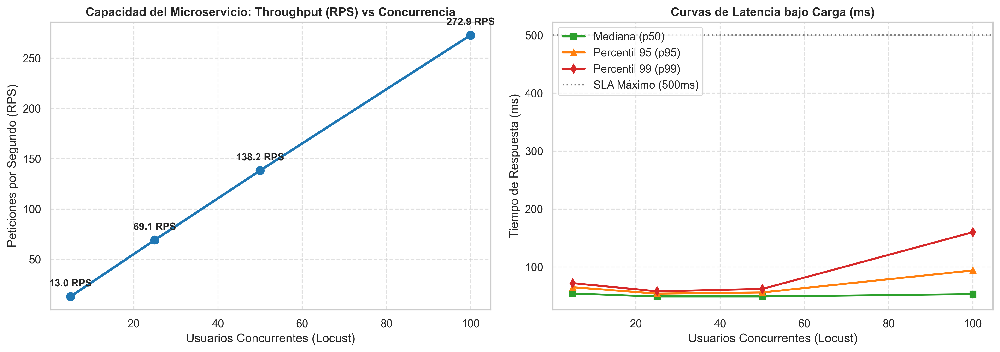
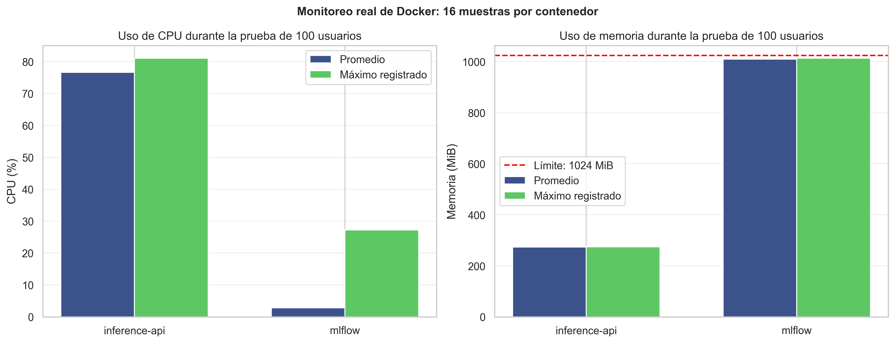
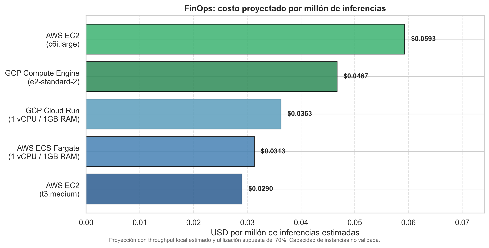
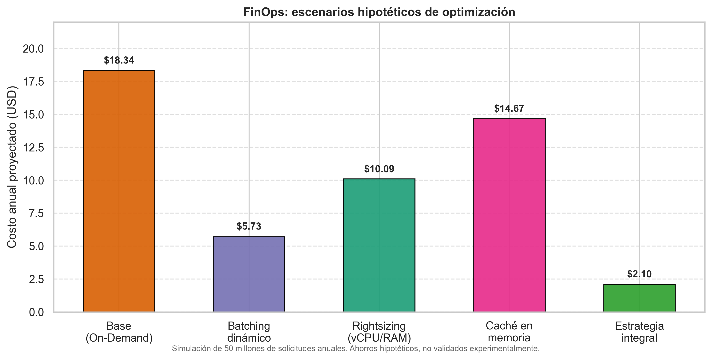

# Reporte Técnico: Pruebas de Carga con Locust, Monitoreo de Recursos y Análisis FinOps

**Proyecto:** MiBici MLOps - Sistema Integral de Inferencia de Demanda Horaria  

**Equipo:** Equipo 51 (Ariadna del Carmen Tapia Miranda, Ingrid Hernández Carrasco, Gabriela Díaz Oropeza)  

**Entregable:** Microservicios, CI/CD y FinOps  

**Fecha:** Noviembre 2026  

---

## 1. Resumen Ejecutivo

El presente reporte documenta la evaluación de rendimiento, el monitoreo de recursos y el análisis financiero (FinOps) del microservicio de inferencia del proyecto MiBici MLOps, desarrollado con FastAPI para servir el modelo Champion CatBoost P1.

Para evaluar el comportamiento del sistema bajo diferentes niveles de concurrencia, se realizaron pruebas de carga mediante Locust con **5, 25, 50 y 100 usuarios concurrentes**, registrando métricas de throughput, latencia y tasa de fallos. Adicionalmente, se utilizó `docker stats` para monitorear el consumo de CPU y memoria de los contenedores de inferencia y MLflow durante la prueba de mayor concurrencia.

Los resultados mostraron que el microservicio alcanzó **272.86 solicitudes por segundo (RPS)** con 100 usuarios concurrentes, una latencia p95 de **94 ms**, una latencia p99 de **160 ms** y una tasa de fallos del **0 %** durante el escenario evaluado. El monitoreo de recursos permitió identificar el comportamiento de CPU y memoria de ambos servicios, así como posibles consideraciones para su dimensionamiento.

A partir de las estadísticas de Locust, se estimó un throughput de **569.05 inferencias por segundo**, considerando las solicitudes individuales y un tamaño promedio supuesto de 7.5 observaciones por lote. Este valor se utilizó como referencia para modelar costos unitarios de inferencia y comparar escenarios de infraestructura en AWS y Google Cloud, bajo supuestos comunes de utilización y capacidad.

Finalmente, se analizaron estrategias hipotéticas de optimización FinOps, incluyendo batching, rightsizing, caché y descuentos comerciales. Sus resultados se presentan como **proyecciones financieras**, no como ahorros validados experimentalmente.

El análisis integra mediciones reales, estimaciones derivadas y simulaciones económicas, proporcionando una base para futuras decisiones de escalabilidad, dimensionamiento y optimización del microservicio.

---

## 2. Arquitectura del Sistema Operable y Despliegue con Docker Compose

El sistema MiBici MLOps utiliza **Docker Compose** para orquestar dos servicios principales: el servidor de seguimiento y registro de modelos MLflow y el microservicio de inferencia desarrollado con FastAPI.

Ambos servicios se construyen a partir del `Containerfile` del proyecto y se comunican mediante la red interna `mibici-net`, utilizando el nombre del servicio `mlflow` para establecer la conexión desde la API.

### 2.1 Componentes de la arquitectura

**Servidor MLflow (`mibici-mlflow`)**

\- Puerto: `5000`.

\- Backend de metadatos: SQLite, montado en `/app/mlflow.db`.

\- Almacenamiento de artefactos: `/app/mlartifacts`.

\- Directorio de modelos: `/app/models`.

\- Ejecución configurada con un worker.

\- Healthcheck: `GET /health` cada 15 segundos.

**Microservicio de inferencia (`mibici-inference-api`)**

\- Framework: FastAPI.

\- Puerto: `8000`.

\- Endpoints: `GET /health`, `POST /predict` y `POST /predict/batch`.

\- Modelo configurado mediante el alias `champion`.

\- Conexión a MLflow: `http\://mlflow:5000`.

\- Healthcheck: `GET /health` cada 15 segundos.

\- Dependencia de arranque: MLflow debe alcanzar el estado saludable antes de iniciar el servicio de inferencia.

### 2.2 Configuración de recursos

Los contenedores cuentan con límites y reservas de recursos definidos en Docker Compose:

\| Recurso | API de inferencia | MLflow |

\|---|---|---|

\| Límite de CPU | 1 CPU | 1 CPU |

\| Reserva de CPU | 0.25 CPU | 0.20 CPU |

\| Límite de memoria | 1024 MiB | 1024 MiB |

\| Reserva de memoria | 256 MiB | 256 MiB |

\| Política de reinicio | `unless-stopped` | `unless-stopped` |

Ambos servicios utilizan una política de verificación de salud con intervalos de 15 segundos, tiempo de espera de 5 segundos, cinco reintentos y un periodo inicial de 10 segundos.

### 2.3 Configuración temporal para las pruebas de carga

Durante la preparación del entorno de pruebas se identificó una incompatibilidad de migraciones en la base de datos SQLite original de MLflow.

Para preservar la base de datos del repositorio, se utilizó un archivo adicional de Docker Compose que sustituye únicamente el montaje de `/app/mlflow.db` por una base de datos de pruebas ubicada fuera del proyecto.

La configuración se obtuvo combinando los archivos:

```powershell

docker compose -f docker-compose.yml -f D:\MLOps\mlflow-docker-test\compose.override.test.yaml config

```

Esta configuración permitió mantener los servicios, límites de recursos, puertos y verificaciones de salud definidos originalmente, utilizando una base de datos independiente para el entorno de evaluación.

La modificación fue específica para las pruebas y no constituye una migración definitiva del almacenamiento de MLflow.

### 2.4 Consideraciones de reproducibilidad

El despliegue utiliza imágenes construidas a partir del código fuente del proyecto, volúmenes para modelos y artefactos, y una red interna para la comunicación entre servicios.

Para reproducir las pruebas de carga, es necesario considerar tanto la configuración principal de Docker Compose como el archivo adicional utilizado para MLflow, además de disponer de los modelos y artefactos requeridos por la API.

---

## 3. Pruebas de Carga con Locust

### 3.1 Diseño del escenario y distribución de tráfico

Se utilizó **Locust** para evaluar el comportamiento del microservicio de inferencia MiBici bajo diferentes niveles de concurrencia, ejecutando pruebas con **5, 25, 50 y 100 usuarios virtuales**.

El escenario se implementó en `tests/load/locustfile.py`, simulando solicitudes a tres endpoints de la API:

\| Endpoint | Peso de tarea | Propósito |

\|---|---:|---|

\| `GET /health` | 1 | Verificar la disponibilidad del servicio |

\| `POST /predict` | 8 | Ejecutar inferencias individuales |

\| `POST /predict/batch` | 2 | Ejecutar inferencias por lotes de 5 a 10 observaciones |

Los pesos representan la frecuencia relativa de ejecución de las tareas, no porcentajes exactos de solicitudes observadas.

Se emplearon tiempos de espera aleatorios entre 0.1 y 0.5 segundos para simular intervalos entre solicitudes.

Durante las pruebas se registraron las siguientes métricas:

\- **Throughput (RPS):** solicitudes HTTP procesadas por segundo.

\- **Latencia p50, p90, p95 y p99:** tiempos de respuesta correspondientes a distintos percentiles.

\- **Tasa de fallos:** proporción de solicitudes que Locust registró como fallidas.

\- **Concurrencia:** cantidad de usuarios virtuales configurados.

### 3.2 Resultados de rendimiento observados

Los resultados obtenidos a partir de los archivos CSV de Locust fueron:

\| Usuarios | Solicitudes | RPS | p50 (ms) | p90 (ms) | p95 (ms) | p99 (ms) | Fallos |

\|---:|---:|---:|---:|---:|---:|---:|---:|

\| 5 | 380 | 13.03 | 54 | 62 | 65 | 72 | 0 % |

\| 25 | 4,099 | 69.14 | 49 | 53 | 54 | 58 | 0 % |

\| 50 | 8,188 | 138.19 | 49 | 54 | 56 | 62 | 0 % |

\| 100 | 16,147 | 272.86 | 53 | 69 | 94 | 160 | 0 % |



### 3.3 Interpretación de resultados

**Escalabilidad del throughput**

El sistema mostró un incremento del throughput conforme aumentó la concurrencia, alcanzando **272.86 RPS con 100 usuarios virtuales**.

Entre los escenarios de 25 y 100 usuarios, el throughput aumentó aproximadamente 3.95 veces, mientras que la concurrencia se multiplicó por cuatro. Esto sugiere un comportamiento cercano al escalamiento proporcional dentro del intervalo evaluado.

**Comportamiento de latencia**

Las latencias se mantuvieron relativamente estables entre 5 y 50 usuarios. En el escenario de 100 usuarios se observó un incremento en los percentiles superiores:

\- p50: 53 ms.

\- p95: 94 ms.

\- p99: 160 ms.

La diferencia entre p50 y p99 indica que algunas solicitudes experimentaron tiempos de respuesta mayores bajo la carga más elevada.

Como referencia visual, la gráfica incorpora un umbral de 500 ms. Este valor se utiliza únicamente como criterio ilustrativo de comparación y no representa un SLA formalmente validado.

**Estabilidad durante las pruebas**

Locust registró una tasa de fallos del **0 % en los cuatro escenarios**, lo que indica que no se detectaron solicitudes fallidas durante las ejecuciones observadas.

Este resultado es favorable, aunque no garantiza la ausencia de fallos ante cargas mayores, ejecuciones prolongadas o condiciones diferentes.

### 3.4 Estimación del throughput de inferencias

Debido a que el endpoint `POST /predict/batch` procesa múltiples observaciones por solicitud, el throughput HTTP no equivale directamente al número de inferencias ejecutadas.

Para estimar las inferencias procesadas durante la prueba de 100 usuarios se utilizaron los siguientes datos:

\| Métrica | Valor |

\|---|---:|

\| Solicitudes a `/predict` | 11,745 |

\| Solicitudes a `/predict/batch` | 2,924 |

\| Tamaño promedio supuesto del lote | 7.5 observaciones |

\| Solicitudes HTTP totales | 16,147 |

\| Throughput HTTP | 272.86 RPS |

El número estimado de inferencias se calculó mediante:

**Inferencias estimadas = Solicitudes individuales + (Solicitudes por lote × Tamaño promedio del lote)**

\\[

N\_{\text{inferencias}} = 11745 + (2924 \times 7.5) = 33675

\\]

A partir de la cantidad total de solicitudes y el throughput HTTP registrado, se estimó la duración efectiva del escenario:

\\[

T\_{\text{estimado}} = \frac{16147}{272.856} \approx 59.18\text{ s}

\\]

Por lo tanto, el throughput estimado de inferencias fue:

\\[

\text{Inferencias/s} = \frac{33675}{59.18} \approx 569.05

\\]

Este resultado representa una **estimación basada en el tamaño promedio supuesto de los lotes**, no una medición directa del número de predicciones individuales procesadas.

La estimación se utiliza posteriormente como referencia para el análisis FinOps.

---

## 4. Monitoreo de Recursos de los Contenedores (`docker stats`)

### 4.1 Metodología de monitoreo

Durante la prueba de carga con **100 usuarios virtuales de Locust**, se recopiló información sobre el consumo de CPU y memoria de los contenedores `mibici-inference-api` y `mibici-mlflow`, utilizando `docker stats`.

Las mediciones se filtraron para considerar únicamente el intervalo de ejecución monitoreado, comprendido entre las **14:07:04 y las 14:08:03 del 22 de noviembre de 2026**.

Para cada contenedor se calcularon el consumo promedio y el valor máximo observado de CPU y memoria, a partir de 16 muestras recopiladas durante dicho intervalo.

Ambos contenedores tenían configurados los siguientes límites:

\- CPU: 1 CPU por contenedor.

\- Memoria: 1024 MiB por contenedor.

### 4.2 Resultados observados


| Contenedor | CPU promedio | CPU máxima observada | RAM promedio | RAM máxima observada |
|---|---:|---:|---:|---:|
| `mibici-inference-api` | 76.61 % | 81.01 % | 273.68 MiB | 274 MiB |
| `mibici-mlflow` | 2.82 % | 27.26 % | 1009.71 MiB | 1013 MiB |




Los valores corresponden a las muestras registradas durante la prueba de 100 usuarios. No representan máximos absolutos del sistema ni describen el comportamiento de los escenarios de menor concurrencia.

### 4.3 Interpretación de resultados

**Consumo de CPU de la API**

El microservicio de inferencia presentó una utilización promedio de CPU del **76.61 %**, con un máximo observado del **81.01 %**.

Estos resultados muestran una utilización importante de los recursos de procesamiento durante la prueba de mayor concurrencia.

Aunque no se registraron fallos en las solicitudes de Locust, el consumo de CPU sugiere que sería conveniente realizar pruebas adicionales con cargas superiores para identificar el punto de saturación del servicio.

**Consumo de memoria de la API**

La API presentó un consumo promedio de **273.68 MiB**, con un máximo observado de **274 MiB**, equivalente aproximadamente al 26.8 % del límite configurado de 1024 MiB.

Esto indica que, durante el escenario evaluado, la API mantuvo un consumo de memoria considerablemente inferior al límite asignado.

El resultado permite identificar una posible oportunidad de rightsizing, aunque sería necesario evaluar el comportamiento ante otras cargas y condiciones antes de reducir los recursos del contenedor.

**Consumo de recursos de MLflow**

MLflow presentó un consumo promedio de CPU del **2.82 %**, considerablemente inferior al observado en la API.

Sin embargo, su consumo de memoria fue elevado: **1009.71 MiB en promedio**, con un máximo observado de **1013 MiB**, aproximadamente el 98.9 % del límite de 1024 MiB.

Este comportamiento constituye un hallazgo relevante, ya que indica un margen de memoria reducido durante el periodo monitoreado.

Antes de aplicar estrategias de reducción de recursos, sería necesario investigar el consumo de memoria de MLflow y evaluar si el límite actual proporciona suficiente margen operativo.

### 4.4 Consideraciones de capacidad y escalabilidad

Los resultados permiten identificar dos comportamientos diferentes:

\- **API de inferencia:** utilización importante de CPU y consumo moderado de memoria.

\- **MLflow:** baja utilización promedio de CPU y consumo de memoria cercano al límite configurado.

Estas diferencias sugieren que las decisiones de dimensionamiento deben realizarse individualmente para cada servicio.

Para la API, sería conveniente ampliar las pruebas de carga y evaluar el comportamiento ante diferentes asignaciones de CPU.

Para MLflow, se recomienda investigar el consumo elevado de memoria antes de considerar cualquier reducción de recursos.

Finalmente, aunque el microservicio respondió sin fallos durante la prueba de 100 usuarios, los resultados no permiten determinar todavía la capacidad máxima del sistema ni justificar una configuración específica de escalado horizontal.

Se requieren pruebas adicionales de saturación, estabilidad prolongada y recuperación para establecer recomendaciones definitivas de infraestructura.

---

## 5. Análisis FinOps: Estimación del Costo por Inferencia

### 5.1 Metodología de estimación

Para evaluar el costo computacional asociado al servicio de inferencia MiBici, se desarrolló un modelo FinOps que relaciona las tarifas horarias de diferentes servicios de nube pública con el throughput estimado a partir de las pruebas de carga.

A diferencia de una estimación basada únicamente en solicitudes HTTP, este análisis considera que una petición al endpoint `/predict/batch` puede procesar múltiples observaciones.

Durante la prueba de 100 usuarios se obtuvo un throughput de **272.86 solicitudes HTTP por segundo**, equivalente a aproximadamente **569.05 inferencias por segundo estimadas**, considerando un tamaño promedio supuesto de 7.5 observaciones por lote.

Para la comparación financiera se utilizó un factor de utilización hipotético del **70 %**, con el objetivo de representar un escenario en el que la infraestructura no opera continuamente a su máxima capacidad.

El costo unitario se estimó mediante:

\\[

\text{Costo por inferencia} =

\frac{\text{Tarifa horaria (USD/h)}}

{\text{Inferencias/s} \times 3600 \times \text{Utilización}}

\\]

El costo por millón de inferencias se calculó como:

\\[

\text{Costo por 1M inferencias} =

\text{Costo por inferencia} \times 1{,}000{,}000

\\]

Estas expresiones permiten estimar el costo computacional proporcional al volumen procesado, suponiendo que cada configuración puede sostener el throughput utilizado como referencia.

### 5.2 Comparación de costos entre proveedores de nube

Se consideraron cinco configuraciones ilustrativas de AWS y Google Cloud, utilizando las tarifas horarias definidas en el catálogo del proyecto.

\| Proveedor | Servicio | Configuración | Tarifa horaria (USD) | Costo por 1M inferencias (USD) |

\|---|---|---|---:|---:|

\| AWS | EC2 | t3.medium | $0.0416 | $0.0290 |

\| AWS | ECS Fargate | Contenedor | $0.0449 | $0.0313 |

\| GCP | Cloud Run | Contenedor | $0.0520 | $0.0363 |

\| GCP | Compute Engine | e2-standard-2 | $0.0670 | $0.0467 |

\| AWS | EC2 | c6i.large | $0.0850 | $0.0593 |



Bajo los supuestos establecidos, **AWS EC2 t3.medium presenta el menor costo unitario proyectado**, seguido de AWS ECS Fargate y GCP Cloud Run.

Sin embargo, esta clasificación representa exclusivamente una comparación económica bajo un throughput común.

No se realizaron pruebas de carga sobre estas configuraciones de nube, por lo que no se ha verificado que puedan alcanzar el rendimiento observado en el entorno local.

### 5.3 Alcance y limitaciones del modelo

Los resultados deben interpretarse considerando las siguientes limitaciones:

\- **Throughput estimado:** las 569.05 inferencias/s se calcularon a partir de las solicitudes registradas por Locust y un tamaño promedio supuesto de lote.

\- **Utilización hipotética:** el factor del 70 % no corresponde a una medición de utilización anual.

\- **Capacidad no validada:** se aplica el mismo throughput a todas las configuraciones sin verificar su rendimiento individual.

\- **Tarifas ilustrativas:** los precios provienen del catálogo del proyecto y no constituyen cotizaciones actualizadas de los proveedores.

\- **Costos no incluidos:** el modelo no incorpora almacenamiento, transferencia de datos, servicios auxiliares, operación, observabilidad ni otros cargos asociados al despliegue.

\- **Facturación real:** las estimaciones no representan necesariamente el costo de mantener una instancia encendida durante un periodo completo ni los mecanismos particulares de facturación de servicios administrados.

Por estas razones, los resultados constituyen **proyecciones de costo computacional bajo supuestos definidos**, y no estimaciones definitivas del costo total de operación en producción.

### 5.4 Interpretación FinOps

El análisis demuestra la utilidad de integrar métricas de rendimiento con modelos económicos para explorar alternativas de infraestructura.

La principal aportación es disponer de un procedimiento reproducible que permite actualizar los costos estimados cuando cambian las mediciones de throughput, las tarifas o los supuestos de utilización.

Como siguiente etapa, sería necesario ejecutar pruebas de carga directamente en las configuraciones candidatas, medir su capacidad efectiva y contrastar los costos calculados con los modelos de facturación de cada proveedor.

Esto permitiría pasar de una comparación teórica a una evaluación FinOps sustentada en rendimiento y costos reales.

---

## 6. Estrategias de Optimización FinOps y Escalabilidad

### 6.1 Estrategias de optimización evaluadas

Se desarrolló una simulación financiera para explorar el impacto potencial de cuatro estrategias de optimización del servicio de inferencia MiBici: batching, rightsizing, caching y descuentos comerciales.

Estas estrategias fueron evaluadas mediante el módulo `mibici_mlops/finops/cost_calculator.py`, utilizando supuestos definidos para un escenario hipotético.

**Batching (procesamiento por lotes)**

Consiste en agrupar múltiples observaciones en una misma solicitud para reducir la sobrecarga asociada al procesamiento individual.

En la simulación se asumió una mejora de **3.2 veces en el throughput** respecto al escenario base.

Este factor representa un supuesto de optimización y no una mejora medida mediante las pruebas de Locust.

**Rightsizing (ajuste de recursos)**

Consiste en adecuar la capacidad computacional contratada a las necesidades reales de la aplicación.

Para el modelo se consideró una **reducción hipotética del 45 % en la tarifa horaria** de infraestructura.

Los resultados de monitoreo sugieren que la API podría tener margen para optimizar su asignación de memoria; sin embargo, MLflow presentó un consumo cercano a su límite configurado. Por lo tanto, cualquier ajuste requeriría pruebas adicionales por servicio.

**Caching (almacenamiento en caché)**

Consiste en reutilizar resultados de inferencias previamente calculadas cuando las solicitudes y los requisitos funcionales lo permiten.

La simulación considera una **reducción hipotética del 20 % en los costos computacionales atribuibles a inferencias**.

No se midió la frecuencia de solicitudes repetidas ni se implementó una validación experimental del beneficio de caché.

**Descuentos comerciales**

Se consideró un escenario hipotético en el que la tarifa horaria, después del rightsizing, recibe un **descuento adicional del 35 %**.

Este porcentaje es un parámetro de simulación y no representa una oferta comercial verificada de un proveedor específico.

### 6.2 Parámetros de la simulación

Para evaluar las estrategias se utilizaron los siguientes valores:

\| Parámetro | Valor |

\|---|---:|

\| Tarifa horaria base | $0.0416 USD/h |

\| Throughput base supuesto | 45 solicitudes/s |

\| Factor de utilización | 70 % |

\| Volumen anual de referencia | 50,000,000 solicitudes |

\| Mejora hipotética por batching | 3.2× |

\| Reducción hipotética por rightsizing | 45 % |

\| Reducción hipotética por caching | 20 % |

\| Descuento comercial hipotético | 35 % |

El throughput base de 45 solicitudes/s es un parámetro independiente de la simulación y no debe confundirse con las 569.05 inferencias/s estimadas a partir de la prueba real de Locust.

### 6.3 Comparación de escenarios simulados

El modelo calculó los siguientes costos computacionales proporcionales al volumen anual de referencia:

\| Escenario | Costo anual modelado (USD) | Reducción frente al escenario base |

\|---|---:|---:|

\| Escenario base | $18.34 | 0 % |

\| Batching | $5.73 | 68.75 % |

\| Rightsizing | $10.09 | 45 % |

\| Caching | $14.67 | 20 % |

\| Optimización combinada | $2.10 | Aproximadamente 88.5 % |



Los importes representan costos computacionales calculados mediante el modelo para procesar un volumen de referencia de 50 millones de solicitudes. **No representan facturas anuales reales ni el costo total de mantener infraestructura activa durante un año.**

La estrategia combinada integra las reducciones de tarifa, el aumento supuesto del throughput, el descuento comercial y el beneficio hipotético del caching.

Los porcentajes de ahorro se calculan respecto al escenario base y no deben sumarse directamente, ya que las estrategias actúan sobre diferentes componentes de la fórmula.

### 6.4 Interpretación de resultados y recomendaciones

Los resultados de la simulación muestran que las estrategias relacionadas con el incremento del throughput pueden tener un impacto importante en el costo unitario estimado.

Sin embargo, el beneficio real del batching dependerá de factores como el tamaño de los lotes, el comportamiento de la latencia, la utilización de CPU y las características del modelo.

De forma similar, el rightsizing podría reducir costos de infraestructura, pero únicamente si la nueva configuración mantiene un rendimiento y una estabilidad aceptables.

En el caso de caching, sería necesario analizar la repetición de solicitudes y la validez temporal de las predicciones antes de estimar un beneficio real.

Por último, los descuentos comerciales deberán evaluarse utilizando precios y condiciones contractuales vigentes.

### 6.5 Próximos pasos para validar las optimizaciones

Antes de implementar estas estrategias en un entorno productivo, se recomienda:

\- Realizar pruebas controladas de batching con diferentes tamaños de lote.

\- Evaluar configuraciones alternativas de CPU y memoria para cada contenedor.

\- Investigar el elevado consumo de memoria de MLflow.

\- Medir la proporción de solicitudes que podrían beneficiarse de caching.

\- Validar las tarifas y descuentos aplicables a las configuraciones candidatas.

\- Comparar los costos proyectados con métricas reales de infraestructura y facturación.

De esta manera, las simulaciones FinOps podrán utilizarse como punto de partida para diseñar experimentos que permitan cuantificar ahorros reales sin comprometer el rendimiento del sistema.

---

## 7. Conclusiones y Recomendaciones Operativas

### 7.1 Conclusiones generales

La evaluación del microservicio de inferencia MiBici permitió integrar pruebas de carga con Locust, monitoreo de recursos mediante Docker y estimaciones financieras basadas en principios FinOps.

Los resultados proporcionan una referencia inicial del comportamiento del sistema y permiten identificar oportunidades de mejora que deberán validarse mediante experimentos adicionales.

**Rendimiento y estabilidad**

Las pruebas de carga mostraron un incremento del throughput conforme aumentó la concurrencia, alcanzando **272.86 solicitudes HTTP por segundo con 100 usuarios virtuales**.

En este escenario se registraron latencias de **94 ms en el percentil 95** y **160 ms en el percentil 99**, sin solicitudes fallidas reportadas por Locust.

Considerando el procesamiento por lotes, se estimó un throughput de **569.05 inferencias por segundo**, utilizando un tamaño promedio supuesto de 7.5 observaciones por lote.

Estos resultados muestran un comportamiento favorable dentro de los escenarios evaluados, aunque no permiten establecer la capacidad máxima del sistema ni garantizar su rendimiento bajo condiciones de producción.

**Utilización de infraestructura**

El monitoreo durante la prueba de 100 usuarios permitió identificar diferencias importantes entre los contenedores.

La API presentó un consumo promedio de CPU del **76.61 %** y un consumo promedio de memoria de **273.68 MiB**, mientras que MLflow registró un consumo promedio de CPU del **2.82 %** y un consumo promedio de memoria de **1009.71 MiB**.

El elevado consumo de memoria de MLflow, cercano al límite configurado de 1024 MiB, representa un punto de atención para futuras evaluaciones de estabilidad y dimensionamiento.

**Análisis financiero**

El modelo FinOps permitió estimar costos computacionales por inferencia para distintas configuraciones de AWS y Google Cloud, utilizando el throughput estimado a partir de Locust y un factor hipotético de utilización del 70 %.

Bajo estos supuestos, AWS EC2 t3.medium presentó el menor costo unitario proyectado entre las alternativas consideradas.

Sin embargo, no se verificó experimentalmente la capacidad de estas configuraciones para sostener el rendimiento observado en el entorno local, por lo que los resultados deben interpretarse como una comparación financiera preliminar.

**Optimización de costos**

La simulación de estrategias FinOps permitió explorar el impacto potencial de batching, rightsizing, caching y descuentos comerciales.

El escenario combinado proyectó una reducción aproximada del **88.5 %** respecto al costo computacional proporcional del escenario base simulado.

Este resultado corresponde exclusivamente a un modelo hipotético y no representa ahorros medidos ni una reducción comprobada de la facturación de infraestructura.

### 7.2 Recomendaciones operativas

A partir de los resultados obtenidos, se proponen las siguientes acciones:

1. **Ampliar las pruebas de rendimiento.** Ejecutar escenarios con mayor concurrencia y pruebas prolongadas para identificar límites de capacidad, degradación de latencia y posibles fallos bajo carga sostenida.

2. **Investigar el consumo de memoria de MLflow.** Analizar las causas del consumo cercano al límite configurado y evaluar alternativas de dimensionamiento antes de modificar su asignación de recursos.

3. **Evaluar el rightsizing de la API.** Realizar pruebas controladas con diferentes límites de CPU y memoria para determinar si es posible reducir recursos sin afectar el rendimiento ni la estabilidad.

4. **Validar el rendimiento en infraestructura de nube.** Ejecutar pruebas de carga en las configuraciones candidatas de AWS y Google Cloud para comparar throughput, latencia y costos bajo condiciones equivalentes.

5. **Medir experimentalmente las estrategias FinOps.** Evaluar distintos tamaños de lote, identificar oportunidades reales de caching y verificar las condiciones comerciales antes de estimar ahorros definitivos.

6. **Fortalecer la observabilidad.** Mantener registros de latencia, throughput, fallos, CPU y memoria que permitan detectar tendencias, investigar incidentes y sustentar decisiones de capacidad.

7. **Mejorar la reproducibilidad del entorno de pruebas.** Documentar las configuraciones de Docker Compose, las dependencias, los datos de prueba y el procedimiento de preparación de MLflow, incluyendo el uso de la base de datos temporal.

### 7.3 Cierre

La integración de pruebas de carga, monitoreo de infraestructura y análisis FinOps constituye una base para tomar decisiones técnicas y económicas informadas durante el ciclo de vida de un sistema de aprendizaje automático.

En el proyecto MiBici MLOps, esta evaluación permitió identificar un rendimiento favorable en los escenarios probados, diferencias relevantes en el consumo de recursos de los servicios y oportunidades hipotéticas de optimización financiera.

El principal resultado es la construcción de un procedimiento reproducible para relacionar **capacidad de procesamiento, utilización de recursos y costo estimado por inferencia**.

Como siguiente etapa, será necesario validar los resultados en infraestructura de nube, ampliar las pruebas de estabilidad y contrastar las simulaciones financieras con mediciones reales antes de establecer recomendaciones definitivas para producción.
